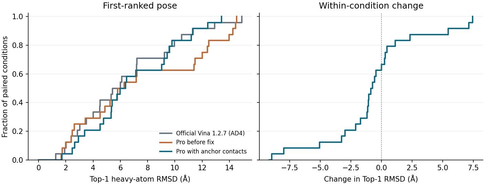

# AD4 对接中的柔性残基固定轴接触

在 Meeko 标准刚柔拆分中，柔性文件含有固定的 α 碳、β 碳，以及由扭转自由度驱动的残基原子。AutoGrid 的输入为剩余的刚性文件。父版 AD4 只计算配体与柔性部分**可动**原子的非键作用。固定轴在空间中不动，配体仍可相对它们移动。两个轴原子成了没有排斥、色散、静电和去溶剂化作用的空位。标准教程和本次四份实验受体的拆分均可逐原子核对。[官方柔性对接教程](https://autodock-vina.readthedocs.io/en/latest/docking_flexible.html) · [选择性受体柔性的原始方法](https://doi.org/10.1002/jcc.21256) · [AD4 力场](https://doi.org/10.1002/jcc.20634)

`model::append` 现在对两种原子表示均构造配体到固定轴的显式对。AD4 使用每个具体原子对的表索引、类型及部分电荷，XS 沿用既有类型索引。固定端力不参与自由度更新，配体端力参与平移、旋转和扭转。重复加入配体时原子索引随模型重排。扩展的生产对象测试覆盖两次依次加入配体、遗漏、重复及错误表地址。固定侧链根有多个原子时，算法使用实际解析的全部固定原子。通常采用 Meeko 分割的输入需满足刚性图和柔性文件无重复原子。

## 相同坐标上的能量与排序

对于同一姿势，修正后的分数增量为每个配体原子与每个固定轴原子的 AD4 显式非键能之和，单位 kcal/mol。此面板的固定轴均为碳，所以受影响的分项为 12–6 势、距离依赖介电常数的库仑势和高斯去溶剂化项。它们在现有 AD4 表格的同一距离节点求和。用于最终打分的每对能量采用父版的相邻节点均值和正能量限幅，网格及构象依赖项照原程序计算。改动仅恢复缺失的 pair，仍然继承 AD4 的近似和数值查表模型。

对父版所有 94 个输出重放，保留每个配体和侧链的 **PDBQT 输出精度**坐标。两次生产 CLI 打分与第三份 Python 径向势实现独立比对。增量范围 −0.521 至 +27.252 kcal/mol，最大差 0.000958，落在两次三位小数打分作差的舍入误差内。所有配体–刚性网格、总内部能和扭转项相同。最大变化出现在 3FMZ 配体对接 1RBP、种子 120997 的第五姿势，最近轴接触 1.860 Å，首要原因是碳轴的短程排斥被漏掉。独立的官方 ABL–伊马替尼 1FPU 教程用原配套图和公布的 6 个柔性姿势复算，六个增量为 −0.267 至 −0.167，最大残差 0.000693 kcal/mol，首位相同。[94 个逐姿势分项](results/fixed.csv) · [ABL 跨体系复核](results/abl_fixed.csv)

在这 24 个固定父版输出池上，仅 2 个首姿发生变化。两次均使 RMSD 上升，幅度 1.773 和 0.285 Å。修复能量不等于给定候选池的几何排序改善。[每个固定池的原始选择](results/fixed_choices.csv)

## 配对结构预测

以 FABP4 的 2NNQ、3FR2 及其 Thr60 为机制组，以 RBP4 的 1RBP、3FMZ 及其 Gln98 为预指定转移组。四种查询各向同靶两个受体对接。每个组合使用 3 枚种子，各 1 条轨迹、名义上限 12000 次求值、9 个输出名额。三臂共享输入及 AutoGrid 图。两组均来自过往 Vina 柔性试验，当时选侧链用过晶体信息；本轮 AD4 结构效应在冻结方案后测量。每个查询沿用 CCD 化学等价重原子映射，并用两种受体口袋中共同匹配且距相应口袋中心小于 14 Å 的 Cα 对齐。测量配体的受体框架内 RMSD。24/24 条件每臂均有输出。[结构协议](PROTOCOL.md) · [实际输入来源](../cubic_grid/flex_replay/README.md) · [逐病例](results/cases.csv) · [全部 284 个姿势](results/modes.csv)

| 各臂 24 条件，单位 Å | 官方 Vina 1.2.7，AD4 | 父版 Pro | 修正版 Pro |
|---|---:|---:|---:|
| 首姿均值 | 6.367 | 7.507 | 6.902 |
| 首姿 Q25 / 中位数 / Q75 | 3.380 / 5.712 / 9.335 | 3.224 / 6.033 / 12.108 | 4.700 / 6.184 / 9.477 |
| 首姿 P90 / P95 / 最大值 | 11.059 / 12.677 / 14.903 | 14.174 / 14.418 / 14.531 | 11.290 / 12.255 / 13.409 |
| 前五最小 RMSD 均值 | 5.583 | 7.148 | 6.047 |
| 全部**已输出**姿势最小 RMSD 均值 | 5.505 | 7.147 | 6.047 |
| 首姿与输出池最佳之差的均值 | 0.862 | 0.360 | 0.855 |
| 已输出姿势数 | 99 | 94 | 91 |



[完整 ECDF 表](results/ecdf.csv)可由 `ecdf.py` 对 `results/cases.csv` 重新计算。

16/24 条件的首姿改善，8/24 退化，配对差均值 −0.605、中位数 −0.804 Å。首姿 ≤2 Å 从 3/24 降至 1/24。右尾收缩，同时 Q25 和中位数上升。固定八个查询–受体格，对三枚共用种子做联合块 Bootstrap 的全部 27 种抽样，配对均值条件区间为 [−1.757,+0.768] Å。三枚种子提供的随机性信息有限，这个区间不含化学和蛋白总体不确定性。每个条件的同种子设计也不保证两版经历相同搜索路径。[完整分布](results/distributions.csv) · [配对变化](results/paired.csv) · [条件区间](results/conditional_intervals.csv)

- FABP4 首姿均值 5.572→5.262 Å，中位数 5.524→5.379，P95 9.586→6.766。
- RBP4 首姿均值 9.442→8.543 Å，中位数 11.747→9.517，P95 14.484→12.864。该靶 Q25 从 2.578 上升到 7.500。最明显的两种相反变化来自相同 1RBP 查询、同一枚种子 87911。受体 1RBP 上 11.403→2.464 Å，受体 3FMZ 上 1.985→9.437 Å。

固定父版池的重排无法解释端到端的平均改善，重新搜索后输出池几何覆盖才发生变化。精确到首次分歧的 MC 轨迹、筛选前所有极小值及其完整 oracle 未记录。数据支持修复可验证的漏项，也显示该局部物理修正可以破坏原来偶然命中的搜索轨迹或排名。

## 同一测定的实测结合强弱

在人 FABP4 同一次竞争结合实验的五种配体上，每种算法完成五种配体 × 两个共同受体 × 三枚种子的 30 次搜索，取得 30/30 首姿。实测 K_L 换算为 pK，负的首姿经验评分用于预测强度；主分析对两受体、三种子等权。十对的报告误差带均不重叠，实际预测无并列，共用配体产生相关性。每行只代表同一实验系列。[原始论文与表 1](https://doi.org/10.1107/S2053230X14027897) · [分析协议](ASSAY_PROTOCOL.md) · [实测值](../archive_overlap/transfer/fabp4/assay/measured.csv) · [逐配体](results/assay_predictions.csv) · [逐对](results/assay_pairs.csv)

| FABP4 | Spearman 父→新 | Kendall τ-b 父→新 | 分子对方向 父→新 |
|---|---:|---:|---:|
| 两受体等权 | 0.80→0.90 | 0.60→0.80 | 8/10→9/10 |
| 2NNQ | 0.70→0.60 | 0.60→0.40 | 8/10→7/10 |
| 3FR2 | 0.90→1.00 | 0.80→1.00 | 9/10→10/10 |

等权结果的全部增益来自 L3/L4（实验 73 与 148 μM），原评分差预测反向 0.078，修正后给出正确方向 0.289 kcal/mol。实测至少三倍的八对在两版均为 8/8。R/S 布洛芬具有相同大小、组成与形式电荷，两版均把较弱的 R 型排在较强的 S 型之前。五种配体均继承原归档的中性羧酸输入。实验 pH 6.5 下的酸碱平衡、结合微态、刚柔重组和溶剂效应均未得到完整描述。一个系列、一个改善对及相反的受体效应不足以确立通用亲和力收益。没有计算标准结合自由能或 ΔΔG。[全部亲和力运行](results/assay_cells.csv) · [统计](results/assay_metrics.csv)

## 成本、代码和复现

GCC 14.2.0，Boost 1.83，AutoGrid 4.2.6，Python 3.12.14，NumPy 2.3.5，SciPy 1.17.0。结构测试的总墙钟 13.62→14.86 秒，CPU 13.53→14.77 秒，逐进程 RSS 中位数 97.94→108.80 MiB。hunt 加第二阶段局优求值 288766→288637 次，AD4 无显式最终精修。增加的原子对在预计算时产生额外按原子对的表，在每次内循环中增加距离及查表工作。四份受体图共 16.84 秒、仅算一次，所有臂共享。单机单次成本受当时负载影响。官方版总墙钟 26.45 秒，其输出未公开内部求值计数。网格、分割及二进制摘要保存在 results/maps.json 与 results/binaries.json。PDBQT 和日志全部置于 raw.tar.xz。

以下从仓库根目录执行；`BASE_BIN` 为 fab52f7 的构建产物，`FIXED_BIN` 为修正后的可执行文件，`AUTOGRID` 和 `OFFICIAL` 为 AutoGrid4 与官方 Vina 1.2.7 可执行文件绝对路径。两个版本都用 tools/build.py。要单独重算统计，可直接在 results 目录副本上运行 summarize.py。

```sh
D=benchmarks/ad4_flex_anchors
W=$(mktemp -d)
mkdir "$W/inputs" "$W/flex"
tar xf benchmarks/cubic_grid/human_panel/prepared.tar.xz -C "$W/inputs"
tar xf benchmarks/cubic_grid/flex_replay/flex-pools.tar.xz -C "$W/flex"
python "$D/panel.py" "$W/inputs" "$W/flex" "$W/experiment" "$AUTOGRID" "$BASE_BIN" "$FIXED_BIN" --official "$OFFICIAL"
python "$D/fixed.py" "$W/experiment" "$BASE_BIN" "$FIXED_BIN"
python "$D/summarize.py" "$W/experiment"
python "$D/assay.py" "$W/experiment" "$W/flex" "$BASE_BIN" "$FIXED_BIN"
python "$D/tutorial.py" "$UPSTREAM/example/flexible_docking/solution" "$BASE_BIN" "$FIXED_BIN" "$W/experiment/abl_fixed.csv"
```

教程取自 [AutoDock Vina 源码 3c65c0b](https://github.com/forlilab/AutoDock-Vina/tree/3c65c0b3e6c2c1d183f6a175ecb65e3c5ba91645/example/flexible_docking)。修复后的 AD4 网格与根部接触 C++ 回归、CLI 域检查均通过；同一个扩展的 C++ 测试链接到父版时明确报告缺失 AD4 ligand–anchor contact。
