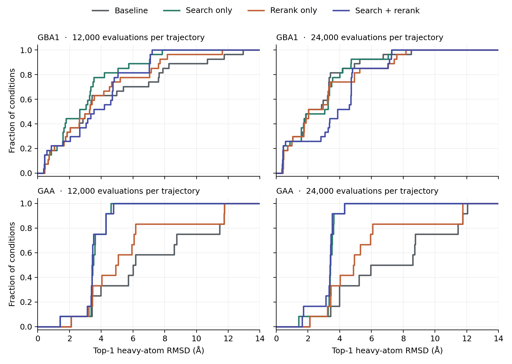

# 把 CH–π 吸引放进搜索后，哪些近晶体姿势才会出现？

新的人酸性 α-葡糖苷酶 GAA 上，搜索阶段加入 CH–π 相互作用使原先未返回的构象进入输出池。每轨迹 24000 次名义求值时，原生、仅改搜索、仅改最终重排、两者同时启用的全配体首姿 RMSD 均值依次为 7.168、3.345、5.566、3.180 Å。人 GBA1 的同档结果依次为 2.629、2.661、2.997、3.617 Å。新势保留在独立研究构建中。[首次方案](PROTOCOL.md) · [GAA 事前方案](GAA_PROTOCOL.md) · [官方与扩大原生预算对照](control/README.md)

## 评分模型和何时介入预测

Xiao 与 Woods 用甲烷–苯的量子化学计算拟合脂肪族 CH 与芳香碳之间的距离势，并在 AutoDock Vina 中评估。本轮沿用已发表模型和权重，在本分支专门分离采样与重排的贡献。实验配体均无芳香碳，只有从配体饱和带氢碳到蛋白芳香碳的方向起作用。Meeko/CCD 化学图和蛋白原子名决定类型，输入的供体序号和芳香碳坐标可逐一核对。[原论文](https://doi.org/10.1021/acs.jctc.3c00300) · [此前固定池实验](../ch_pi_transfer/README.md)

每对原子的附加项为 $-0.3\times0.26\exp[-(r-4.49)^2/(2\times0.75^2)]$，单位 kcal/mol，距离单位 Å；使用 8 Å 截断。搜索阶段在原生 0.375 Å 晶格上累加该项。平移、转动和扭转的导数由同一三线性插值获得。晶格外钳位额外场，原生网格施加一次盒边界罚。候选的显式精修和返回前筛选沿用原干势。重排阶段在输出坐标上重新求解析项，加入原生分数前应用原有转子因子，选取总分最低者。每一阶段只计算一次该项。该有效势省略显式氢方位、芳环电子结构、去溶剂化和相邻极性接触的竞争。没有拟合新参数，也没有建立溶液标准态结合自由能模型。[C++ 搜索场](search_grid.h) · [嵌入全局搜索的改动](search.patch) · [预测与评估程序](study.py)

## 固定输入和预算的四臂

每格指定配体、受体、种子及预算。每种搜索产生一个池，在该池上应用两种排序。搜索的开关可以改变轨迹、候选和实际求值次数。重排只改变已返回池内的次序。GBA1、GAA 使用 Late 选姿、40 个精修名额；GCK 和 GLUT3 沿用原实验的 native 选姿。所有池最多返回九个模式。GCK 与 GLUT3 的跨蛋白差异还包含选姿协议和配体化学类型的差异。

| 蛋白、每轨迹预算 | 条件数 | 原生 | 仅搜索场 | 仅重排 | 两者合用 | 返回池最小 RMSD 均值，原生→搜索场 |
|---|---:|---:|---:|---:|---:|---:|
| GAA，12000 | 12 | 6.926 | 3.534 | 5.656 | 3.491 | 4.692 → 2.242 |
| GAA，24000 | 12 | 7.168 | 3.345 | 5.566 | 3.180 | 4.680 → 1.920 |
| GBA1，12000 | 27 | 4.339 | 2.923 | 3.734 | 3.630 | 2.579 → 2.289 |
| GBA1，24000 | 27 | 2.629 | 2.661 | 2.997 | 3.617 | 1.984 → 1.978 |
| GCK，3000 | 4 | 5.837 | 10.179 | 5.837 | 10.179 | 5.452 → 8.304 |
| GCK，12000 | 4 | 4.905 | 9.413 | 4.905 | 9.413 | 4.708 → 7.211 |
| GLUT3，3000 | 4 | 3.009 | 4.533 | 3.009 | 4.533 | 1.946 → 4.260 |
| GLUT3，12000 | 4 | 2.532 | 4.654 | 2.532 | 5.488 | 1.358 → 4.197 |

表中四臂数值均为首姿全配体重原子 RMSD 均值（Å）。每池保留原子对应，跨受体先以口袋共有 Cα 对齐，配体不独立拟合。历史面板 70 格、140 个池、1257 个姿势，GAA 24 格、48 个池、432 个姿势，全部完成。各分位数、前五最优、返回池最优、排序损失、配对差及逐种子原始分布均可重算。[历史逐格和分布](results/historical/) · [GAA 逐格和分布](results/gaa/)

## GAA 的具体机制和反例

5NN5 与 5NN6 是同一项结构研究中的两种人 GAA 复合物，配体分别为 1-deoxynojirimycin 和 miglitol。用带正电环氮、从带手性分子图嵌入的起始构象完成两次自对接和两个交叉方向，每方向三枚种子。接收受体的口袋中心来自其自身共晶，交叉比较中 62 个口袋 Cα 的对齐 RMSD 为 0.111 Å。5NN5 的 553、895 和 946 号残基只提供 B 侧链坐标。制备程序现在保留这种实测构象，原有三份 GBA1 受体均无此类替换。干受体、固定质子化假设未覆盖溶液中的微态平衡。[原始结构研究](https://doi.org/10.1038/s41467-017-01263-3) · [原始 PDB、CCD、处理后坐标和元数据](gaa_inputs.tar.xz)

5NN5 自对接，种子 43103、24000 档，四臂首姿为 12.053、3.509、11.738、1.714 Å。原生池的最佳姿势只有 7.066 Å。新场产生的 1.714 Å 姿势在原生干分中排第六，落后池内第一名 0.789 分。CH–π 分项提供约 1.034 分的相对优势。其中 Trp516、Phe649、Trp613、His674 分别贡献约 0.505、0.427、0.387、0.338 分，Trp376 和 Trp481 的贡献部分抵消。可在同一组输出坐标验证此次换首。相反，5NN6 自对接，种子 43133、24000 档，原生首姿 2.100 Å，组合 4.303 Å。[逐姿原能量与 RMSD](results/gaa/modes.csv) · [逐残基分项](results/gaa/residue_terms.csv)

两档 GAA 的组合各在 12 格中的 10 格优于原生。24000 档首姿中位数 7.279 → 3.390 Å，P90 为 11.727 → 3.526 Å，P95 为 11.890 → 3.876 Å。相对仅加搜索场，两档的均值额外下降 0.043、0.166 Å，配对差中位数均为零。按查询分子整块重采样，这两项均差的描述性 95% 区间分别为 [−0.105, +0.020]、[−0.351, +0.020] Å。只有两种相近配体，不能据此估计整个蛋白家族的效应。两因素的差中差分别为 +1.227 和 +1.436 Å，在 RMSD 尺度上表示组合收益小于两个单项相加。本例同时体现了局部需要两个阶段，以及总体主要得益于改变搜索。[逐格四臂](results/gaa/pairs.csv) · [配对作用与不确定性](results/gaa/contrasts.csv)

在 GBA1 的 12000 档，单独加搜索场优于同时重排；到了 24000 档，原生平均首姿最好。GCK 和 GLUT3 加入搜索场后，返回池的最佳姿势也普遍变差。仅对候选重新排位无法解释这些退化。GBA1 有一个池的最终校正分差仅 0.000472，小于原输出干分的打印步长。在已保存坐标上显式复算，两个候选换序。把两种选择都纳入，GBA1 的 24000 档组合均值为 3.617–3.763 Å；GAA 全部池均无此量级的首位近并列。[独立重建与近并列敏感性](results/historical/independent.json)

## 成本与可复现性

GAA 24000 档的原生和搜索场各 12 次，对应单核 CPU 合计约 3.48、4.67 秒，搜索求值为 1153082、1153063，显式精修 16941、14442 次。准备两个受体共 17.39 秒，准备两套中性和质子化配体约 0.09 秒。额外独立对照把原生预算提高到 48000，12 次搜索共 5.41 秒 CPU，平均首姿仍为 7.197 Å；同条件官方 Vina 1.2.7 的 12000/24000 档分别为 7.093/7.115 Å。GBA1 的 12000 搜索场与 24000 原生 CPU 合计 9.13/9.26 秒，平均首姿则为 2.923/2.629 Å。墙钟、CPU、峰值内存、搜索与精修计数，以及逐池解析和计分时间分别记录。原版 CLI 的内部求值计数不可得。[GAA 搜索开销](results/gaa/costs.csv) · [历史开销](results/historical/costs.csv) · [追加控制](control/README.md)

研究二进制关闭额外场时，历史 70 个原生对照逐字节复现。独立程序从 PDB/CCD 坐标和图映射重建 RMSD、原子分类与评分，复核 1689 个模式、376 个池内选姿观测。数值测试检验 33 个格点与解析径向势一致，格内 Cartesian 梯度和完整构象自由度梯度均通过中心差分。GAA 48 次对接另用独立构建重放。[数值检查](check.cpp) · [GAA 独立评分](results/gaa/independent.json) · [归档搜索输出](gaa_outputs.tar.xz) · [历史面板输出](historical_outputs.tar.xz)

在仓库根目录运行以下命令。需要 C++14、Boost 和 patch；Python 依赖同此前的 GBA1 与葡萄糖实验。重新制备 GAA 时另需 OpenMM 与 PDBFixer。使用系统 Boost 时可以省略 `--boost-prefix`。

~~~bash
D=benchmarks/ch_pi_search
W=$(mktemp -d)
mkdir -p "$W"/{gba,glucose,gaa}
tar xf benchmarks/ch_pi_transfer/gba1/evidence.tar.xz -C "$W/gba"
tar xf benchmarks/ligand_hydroxyl/glucose/evidence.tar.xz -C "$W/glucose"
tar xf "$D/gaa_inputs.tar.xz" -C "$W/gaa"
python "$D/build.py" --output-dir "$W/build" --boost-prefix "$BOOST_PREFIX" --check-ligand "$W/gaa/5NN5/protonated.pdbqt"
export OPENBLAS_NUM_THREADS=1 OMP_NUM_THREADS=1
python "$D/study.py" "$W/gba" "$W/glucose" "$W/build/vina" "$W/history"
python "$D/gaa.py" "$W/gaa" dock "$W/build/vina" "$W/transfer"
python "$D/summarize.py" "$W/history"
python "$D/summarize.py" "$W/transfer"
python "$D/verify.py" "$W/history" --gba "$W/gba" --glucose "$W/glucose" --binary "$W/build/vina" --out "$W/history/check.json"
python "$D/verify.py" "$W/transfer" --gaa "$W/gaa" --binary "$W/build/vina" --out "$W/transfer/check.json"
python "$D/residue_terms.py" "$W/gaa" "$W/transfer" "$W/transfer/residues.csv"
python "$D/plot.py" "$W/history/cells.csv" "$W/transfer/cells.csv" "$W/ecdf.png"
~~~
