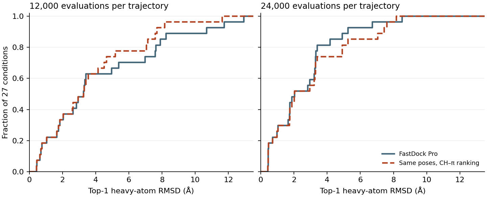

# 人 GBA1 亚氨基糖的首姿误差与搜索预算

在人溶酶体酸性 β-葡萄糖苷酶中，相同的 CH–π 评分在较小候选池搜索预算下改善首姿均值，在搜索预算加倍后反而使均值上升。两档预算均固定输出 9 个姿势，逐池比较时只更换排序。选择较有利的预算会改变这个实验的结论。

## 结构、输入与终点

三种可逆抑制剂为异法戈明 IFM（2NSX，B 链），N-丁基脱氧野尻霉素 NBV（2V3D，A 链），以及 N-壬基同系物 NND（2V3E，A 链）。晶体分辨率依次为 2.11、1.96、2.00 Å。每个查询分别对接自身和其他两个受体，三枚共用种子，共 27 格。实验属于已知口袋下的重对接与交叉对接。每个查询的起始构象均从带手性 CCD 图生成。主实验将环氮质子化，另用中性胺重复。两次搜索都使用干燥刚性受体及默认受体微态。2V3E 的末端 Gln497 只解析到 Cβ，补全侧链在残基 34 附近产生 1.77 Å 的碳–碳碰撞。保留其实测原子，按 Ala 末端处理，该处距配体最近 42.54 Å。跨受体依据口袋共同 Cα 对齐，47–62 个原子，残差 0.082–0.278 Å。全配体重原子 RMSD 使用所有兼容手性和拓扑的映射，无配体拟合。[冻结协议](PROTOCOL.md) · [来源论文](https://pubmed.ncbi.nlm.nih.gov/17666401/) · [结合微态的实验研究](https://pubmed.ncbi.nlm.nih.gov/32191378/) · [对齐记录](results/alignment.csv)

## 不同成本下的首姿分布

下表只含质子化臂。每条轨迹的求值上限分别为 12000、12100 和 24000，每格 4 条轨迹。所有 135 次 CLI 搜索均产出结果，包括中性臂和官方对照。口袋及配体的坐标、完整模式和日志见归档。分项和评分仅用预测时可获得的输入。由于三种配体都没有芳香碳，在这里仅配体脂肪碳到蛋白芳香碳的分项有贡献。

| 每轨迹预算、排序方案 | Top-1 均值 Å | 中位数 Å | P95 Å | 输出池最小 RMSD 均值 Å |
| --- | ---: | ---: | ---: | ---: |
| 12000，官方 Vina 1.2.7 | 4.343 | 3.356 | 10.698 | 2.676 |
| 12000，Pro 原评分 | 4.339 | 3.261 | 11.430 | 2.579 |
| 12000，Pro + CH–π | 3.734 | 3.261 | 8.025 | 2.579 |
| 12100，Pro 原评分 | 4.338 | 3.261 | 11.430 | 2.578 |
| 12100，Pro + CH–π | 3.733 | 3.261 | 8.025 | 2.578 |
| 24000，Pro 原评分 | 2.629 | 2.040 | 6.284 | 1.984 |
| 24000，Pro + CH–π | 2.997 | 2.040 | 7.545 | 1.984 |

在 12000 预算下，有 9 格改善、2 格退化、16 格相同，配对 ΔRMSD 均值 −0.605 Å，中位数 0。三枚种子联合按块重抽样的条件性 95% 区间为 [−1.027, −0.162] Å。9 个 cognate 格的均值仅降 0.091 Å，18 个 cross 格降 0.862 Å。改变主要来自丁基化合物，9 格均值降低 1.717 Å；壬基化合物的均值变化为 +0.002 Å。在同一 2NSX 口袋，NBV 的一次误差从 12.928 降至 4.151 Å，NND 的另一次从 2.841 升到 7.051 Å。整体排序损失从 1.760 降至 1.155 Å，前五最小 RMSD 的均值从 2.747 升至 2.939 Å。[逐格配对](results/paired.csv) · [每个姿势](results/modes.csv) · [完整 ECDF](results/ecdf.csv)

在 24000 预算下，只有 1 格改善，5 格退化，21 格相同，均值变化为 +0.368 Å，种子块条件区间 [+0.239,+0.466] Å。增加搜索本身改善了原评分可选的几何候选，也改变了重排可获益的空间。中性自由碱在 12000 预算下的效应为 −0.095 Å，4 格改善、4 格退化、19 格相同。所有区间仅描述这三个种子在固定面板内的波动。三个配体共享一个家族和有限的骨架，两个微态分别作条件性预测。[全分布](results/distributions.csv) · [双倍预算的配对差](results/cap24000/paired_summary.csv) · [预算对照的确定方式](BUDGET.md)

## 晶体位置附近是否存在有利的能量盆地

在观察到上述结果后，用已知实验位置进行离线诊断。把各查询的重原子按受体对齐，固定重原子以 MMFF 松弛氢，按原评分做一次局部优化，并与相同池中的原生或 CH–π 首选比较。候选与探针都以分子间与分子内能量之和计分，采用相同的旋转分母；同一池内作差后公共参考能抵消。这一步用了实验答案，并允许探针继承原始晶体的键长、键角及环形。它检验局部可容纳性，不证明从预测输入可到达该构象。

局部优化后，9 个不同查询–受体组合的 RMSD 为 0.085–0.345 Å。其中 27 个种子池对照有 24 个在原评分下偏好该局部姿势，26 个在 CH–π 评分下偏好它。保留晶体重原子而尚未局优时，相应计数为 14/27、18/27。三个种子复用了同一局部探针。NND→2NSX 的一格在局部优化后两个评分仍偏好原池中的候选，反映搜索、输入构象和排序均可能构成限制。[逐格能量差及 RMSD](results/crystal_diagnostic.csv)

## 成本与复现

12000 主实验的 27 格 Pro 搜索合计 7.643 s 墙钟、7.538 s CPU；官方对照分别为 29.218 和 29.040 s。Pro 搜索和显式精修各为 1,298,279 和 40,204 次求值。首次实验在同一 Python 进程中建立九套评分器约 0.050 s，重排 243 个姿势约 0.023 s，未计单独起动解释器及 I/O。三种受体预处理共 16.07 s，两种配体微态的制备共 0.29 s。Pro 单进程最大 RSS 的中位数约 132 MiB。扩大预算对照的实测总墙钟为 7.114 和 9.397 s；不同运行受机器负载影响。用完成共价近邻修复的二进制重新运行全部 108 次刚性 Pro 搜索，并再运行 27 次官方对照，135 份输出 PDBQT 与初次实验逐字节一致。[重放记录](results/binary_replay.json) · [原始数据及日志](evidence.tar.xz)

独立审核从原 CCD 和 PDB 重新推导原子对应及受体对齐，复算三个预算的 1,215 个输出姿势，RMSD 最大差 1.78×10⁻¹⁴ Å。又用同一个 score_only 入口重新评分主实验 243 个质子化 Pro 姿势及两组探针，原生首位和所有探针能量差的符号均复现。[独立复核](results/independent.json) · [同入口能量对照](results/independent_placement.csv)

从仓库根目录运行。预处理和搜索可由原始输入重建，直接解包归档即可重新分析。依赖版本、源文件哈希、三个受体的完整处理数据及程序哈希位于归档的 software.json、metadata.json 和 binaries.json。

~~~bash
B=benchmarks/ch_pi_transfer/gba1
W=$(mktemp -d)
tar -xJf "$B/evidence.tar.xz" -C "$W"
python "$B/evaluate.py" "$W" "$W/recomputed"
python "$B/placement.py" "$W" "$VINA_PRO" "$W/recomputed"
for cap in 12100 24000; do
  python "$B/evaluate.py" "$W" "$W/recomputed/cap$cap" --cap "$cap"
done
# 从头运行搜索
OPENMM_CPU_THREADS=1 python "$B/experiment.py" "$W" prepare
python "$B/experiment.py" "$W" dock --pro "$VINA_PRO" --official "$VINA_127"
python "$B/budget.py" "$W" "$VINA_PRO"
~~~
