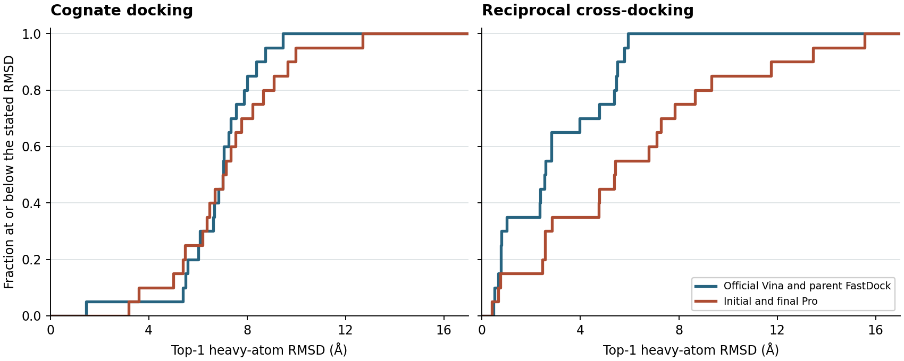

# FastDock 四版本累计性能记录

本轮算法源码为 `5847b1bc061b27d64bba5a9d38a03a26d2bf5068`。在已有跨受体面板上，固定预算的长期姿势精度显著低于真正的父版；本轮两项修复提高了固定姿势评分和发布坐标的可复算性。末版在同一面板没有可用作预测精度提升的增量。

## 固定输入、版本和评价单位

| 组成 | 冻结内容与用途 | 数据与复算 |
|---|---|---|
| 结构纵向测试 | 10 个同晶复合物（8 个靶点）和五靶点双向交叉的 10 个方向。每例两个固定种子，固定设置每臂 40 格。另存 20 个成本分配格和 5 个原生默认设置格。 | [输入与真实四臂运行](../geometry_comparison/upstream/four_versions/) |
| 亲和力纵向测试 | 沿用完整的同靶同测定面板。47 个测定–化合物记录在 7 种受体、9 个分层中产生 70 个配体–受体条件；每臂 140 个固定预算搜索。 | [原始数据、每对方向与实际成本](affinity/) |
| 外部结构 | 新登记 4OCZ、6AUM、4R6E。两份结构不满足原定干受体制备条件，保留在分母。4OCZ 两枚种子的对接在观察评分误差前已运行；其后用于修复验证。 | [三份沉积原件、排除和独立复算](external/) |
| 开发与诊断 | 历史水、环、受体状态、局优与接触几何研究用于提出假设。原始两类纵向面板已被历史开发查看。已揭盲的外检在此后的研发中作为回归数据。 | [物理推导与既有实验](../../docs/BINDING_ENSEMBLE_AND_DOCKING.md) |

四个角色分别为官方 v1.2.7、首个 Pro 提交的真实 Git 父版本、轮前稳定 Pro 和修改后 Pro。官方及父版均固定源码。对每一次算法变更保留完整 SHA、二进制、依赖与默认参数的身份记录。本轮另保留中间候选 `673f226`。四个可执行文件接受相同的已知口袋。姿势按化学等价原子映射在受体坐标系中计算重原子误差。交叉对接参考来自两个实验口袋的 Cα 配准；相应查询在接收受体中的真实姿势通常未被直接测量。[版本和构建哈希](../geometry_comparison/upstream/four_versions/builds.json)

## 本轮读数

| 条件 | 官方 Top-1 均值 (Å) | 父版 | 轮前 Pro | 本轮 Pro | 本轮减父版 (Å) |
|---|---:|---:|---:|---:|---:|
| 同晶，12k / 轨迹，20 格 | 6.794 | 6.794 | 7.175 | 7.175 | +0.381 |
| 交叉，12k / 轨迹，20 格 | 2.863 | 2.863 | 6.016 | 6.016 | +3.153 |
| 交叉，历史 CPU 标定预算，20 格 | 4.709 | 2.536 | 4.746 | 4.746 | +2.210 |
| 原生科学默认设置，5 格，含官方补跑 | 2.372 | 2.372 | 2.774 | 2.774 | +0.402 |

两条曲线分别合并了此次逐格完全重合的版本；40 个固定预算格中实际运行了四臂。相同上限下，同晶与交叉总计，官方、父版、轮前和末版分别使用 77.991、32.529、17.817、16.290 CPU 秒。历史 CPU 标定是预先确定的分配，并非每格严格等时。这一组末版相对官方的 CPU 比值中位数 0.923，范围 0.299–1.836。官方五格默认设置中的 FKBP1A 首次触发 180 秒限制，单独补跑获得结果，原始失败仍计入主要运行收据。姿势长尾、各靶点、各模式、三个基线的逐格差异、成本及失败均在结构报告中。[四臂姿势结果](../geometry_comparison/upstream/four_versions/results/) · [原生默认补跑](../geometry_comparison/upstream/four_versions/default_completion/)

在固定亲和力预算下，官方与父版的 140 个池逐字节一致，轮前与末版的 140 个首姿及其分数逐字节一致。九个测定–受体分层中，末版相对父版的三倍分离对正确数三组增加，五组减少，一组持平。共享化合物和受体的分子对具有相关性。相对轮前有 21 个池变化、28 个非首位模式块变化。以独立复算的每个配体和测定为依据。[逐测定 ρ、τ-b 和分母](affinity/results/assays.csv) · [逐对完整方向](affinity/results/pairs.csv)

## 累计与增量的来源

- 在两段历史版本比较中，每段只有 `src/lib/bfgs.h` 不同。交叉组从父版到早期 Pro 的 Top-1 均值变化 −0.058 Å；随后保留失败线搜索前的已接受点，变化 +2.958 Å；再修正初始逆 Hessian 的尺度，变化 +0.252 Å。第一次数值修复令每格平均多作 739.55 次首轮局优，联合能量/梯度评估反而少 231.90 次。相同评估上限会改变 MC 能访问的轨迹、候选池和最终排序。[历史源码干预与逐格轨迹计数](../geometry_comparison/upstream/four_versions/bfgs_results/)
- 显式给定未结合参考能的公共 API 原先允许越界输入进入墙势，批量评分还丢失返回值。对两个蛋白验证了越界能量与受限原子数和位移的关系；现有输入域、输出身份、逆序和部分失败可独立测试。常规搜索的内部重打分保留相同目标函数。[固定姿势机制检验](../fixed_score_domain/)
- 普通刚性受体精修采用已有的可打印坐标处理后，4OCZ 上四个模式约 40 的原始能量复算偏差均降到 0.015 以内。两种子合池并统一参考和配体拓扑后，候选 Pro 的 376/376 个模式都能评分，轮前为 371/376。21 个合池条件中，更换为共同参考只有一格改变赢家，BRDT 从 3.606 变为 7.531 Å。[原始图、共同参考及完整代价](common_reference/) · [发布前后对照](../fixed_score_domain/publication/)

## 后续记录

[ledger.csv](ledger.csv) 以轮次源码、引擎源码和条件为索引，保存固定主要指标。数据文件在 Git 中按提交保留。原始输入哈希、受体及配体来源、构建配置、真实命令、坐标、CPU/墙钟和计数见各子实验。各阶段无法拆分的计时保持在原始进程总成本中。绝对或相对结合自由能需要额外的结合/游离两相参考、标准态和独立收敛采样。

从仓库根目录运行 `python benchmarks/cumulative/ledger.py` 核对本轮 56 条记录。后续使用新一轮四臂结果生成 `ledger.py --append`，保留历史行。重复测量旧源码时以独立的实验目录和收据保留测量条件。固定集上的长期可比性和新结构上的外部验证分别报告。

## Git 提交溯源

本轮实验和事前登记先在本地 Git 提交，再按原顺序发布到 GitHub。发布时重新生成了提交元数据，每对提交的源码与实验文件树完全相同。正文、构建命令及性能台账采用远端提交号。下列清单保留原始提交对象正文、原始与远端 SHA、公共 tree 以及更新过的出处文件的原始 blob。核对任一条时，用 `git rev-parse <远端SHA>^{tree}` 比较 `tree`；将 `raw_local_commit` 的 UTF-8 原文（含结尾换行）交给 `git hash-object -t commit --stdin` 可重建原始 SHA。原始结果收据也可用 `git show <发布链末端SHA>:<文件路径>` 取回发布归一化前的字节。[本轮提交与文件树映射](git_publication.json)
