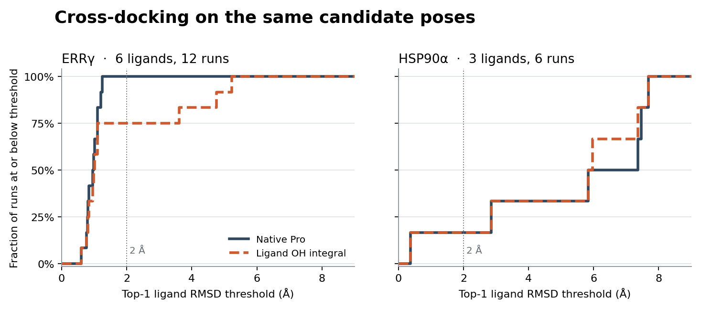

# 如何评价对接姿势和同靶亲和力排序

实验比较有两个主要终点。给一个蛋白和一个配体时，看实际交付的首姿与实验姿势相距多少。给同一测定里的一系列配体时，看算法能否按实验结合强弱排序。两道题分别报告，额外的共晶信息、受体构象、计算预算和物理有效性也分别标明。下文重算的是 7ca6de9 已归档的输出，未重跑搜索，也未根据新指标挑选模型。

## 姿势误差

每次对接的一个观测是首位候选的**对称性校正配体重原子 RMSD**，单位 Å。坐标在同一受体参考系内，跨受体时先对齐蛋白。分子内的对称原子按化学图允许的映射处理。单独将配体叠合到晶体会消除整体放置误差，可另作内部构象诊断。把一个池的所有候选混在一起算平均会受输出名额、重复候选和错误姿势数量影响。

对于一个面板，报告首姿误差的**中位数、均值、分位数与经验累积分布**。中位数描述典型结果，均值反映严重偏离的代价。累积分布在距离 r 处的高度是首姿误差不超过 r 的比例。传统的 2 Å 命中率是其中一个可与历史对照的点。样本少时同时给逐例数值及实际分母，尾部分位数可能主要由一两个配体决定。

| 读数 | 对应的决策 |
|---|---|
| 首姿 RMSD | 使用程序返回的第一名时，离实验位置有多远？ |
| 前五最小 RMSD | 若能进一步复核前五个候选，里面最接近实验的有多好？部署时需要另一个方法选中它。 |
| 全池最小 RMSD | 给定保存规模，是否生成并保留了好姿势？记录池的大小、预算和筛选阶段。 |
| 首姿 RMSD 减全池最小 RMSD | 同一池中，排序让使用者多承担了多少 Å 的误差？同时看池内最小值，整池都错时差距也可以很小。 |
| 配对的新版减基线 RMSD | 对同一查询、受体、预算和种子逐项比较，负值表示更接近晶体。另报改善、持平、退化的数量和最大变化。 |

区分两个汇总问题。若关心随机运行一次的表现，将每个实验组合的多个种子作为重复观测，给各配体、受体设计相应权重。若关心典型配体，先在每个配体或实验组合内聚合种子，再统计配体间分布。两种中位数可能不同。靶点、同系配体、同一配体在不同受体上的重复均需保持可追溯。涉及跨靶概括时应给出逐靶结果与靶点等权汇总，避免配体数量最多的靶点主导结论。逐项登记没有输出、映射失败和化学几何错误的病例。报告返回姿势的条件分布时，同时给出预定病例中有多少可评，保留每次失败的原因。

## 相同坐标上的重新评分

下表选用同一预算的均衡分层，每个查询恰有两个种子。这些分层中每次运行权重相等。分位数取加权经验累积分布的逆，在概率恰好落于累计权重边界时取相邻两个观测的平均值（等权时为第 2 型样本分位数）。两臂共享搜索输出。历史研究中的 bonded 指配体羟基转角积分。

| 分支基线 → 羟基积分，预算 12,000 | 2 Å 首姿命中 | 均值 (Å) | 中位数 (Å) | P90 (Å) |
|---|---:|---:|---:|---:|
| ERRγ 交叉对接，6 个查询 / 12 次运行 | 12/12 → 9/12 | 0.950 → 1.812 | 0.966 → 0.996 | 1.200 → 4.755 |
| HSP90α 交叉对接，3 个查询 / 6 次运行 | 1/6 → 1/6 | 5.259 → 5.008 | 6.595 → 5.894 | 7.685 → 7.685 |

早先一起报告的 136 个候选池中，首姿 2 Å 命中由 40 增至 41，未加权的均值从 4.226 变到 4.231 Å，中位数保持 4.047 Å。该汇总混合多个设计，只用于与历史数字对读。

ERRγ 中 9 次输出相同，3 次退化，其中两个种子重复出现于同一配体。HSP90α 中 5 次输出相同，仅一次由 7.465 Å 改善到 5.959 Å。二者都说明应同时查看个例的幅度与个数。下图从已发布的逐运行首姿生成，可直接在任意距离上读取覆盖率。

同样的问题也出现在池内最小值上。GLUT3 的 α、β 两种异头体共 8 个预算–种子格，干受体与三脂质受体各自进行搜索并按各自分数排名。池内 2 Å 命中由 5/8 上升为 6/8，池内最佳 RMSD 的均值却由 1.652 增至 3.488 Å，中位数从 1.254 降至 0.892 Å。β 异头体的首姿平均误差从 3.785 降到 2.918 Å。α 异头体有两次连池内最接近晶体的候选也偏离超过 10 Å。只有一个受体和两种相关微态，三个数字一起描述这个面板。

## 同一测定内的结合强弱排序

先将精确正值 Ki 或 Kd 统一到 mol/L，取 pK = −log10(K / 1 M)。每个配体得到一个预测分数。当分数越低表示结合越强，计算 Spearman ρ 和 Kendall τ-b 时比较 **−score 与 pK**。正相关才表示排序方向正确。同一浓度即使以不同单位给出也应严格并列。原始 docking score 直接与 pK 求相关会把符号颠倒。

主要报告每个可比 assay 的分子数、Spearman ρ、Kendall τ-b，并列出实验强弱明确的配体对有多少判对、改对、改错。全部实验不等值对和至少三倍差距的子集分开给出。实验等值对在 Kendall τ-b 中保留并列。预测并列时，配对准确率给半分。三倍沿用早先协议，实际有重复实验、标准误或测量区间时，可以直接依据可分辨的方向定义高可信分子对。浓度检出限、上下界和不同机制的 Ki、Kd、IC50 不能直接混作一条精确浓度序列。

| 同测定面板 | 配体数 | Spearman ρ，基线 → 积分 | Kendall τ-b，基线 → 积分 | 实验不等值分子对判对数 | ≥3 倍差距分子对判对数 |
|---|---:|---:|---:|---:|---:|
| 因子 Xa，Ki | 28 | 0.474 → 0.474 | 0.346 → 0.346 | 252/374 → 252/374 | 207/295 → 207/295 |
| Galectin‑3，Kd | 47 | −0.363 → −0.343 | −0.239 → −0.225 | 408/1,074 → 416/1,074 | 113/403 → 116/403 |
| S6K1，Kd | 14 | 0.103 → 0.103 | 0.066 → 0.066 | 48/90 → 48/90 | 32/58 → 32/58 |
| ERRγ，ITC Kd，预算 3,000 | 6 | −0.029 → −0.029 | 0.067 → 0.067 | 8/15 → 8/15 | 3/7 → 3/7 |
| 同一 ERRγ 面板，预算 12,000 | 6 | 0.086 → 0.086 | 0.200 → 0.200 | 9/15 → 9/15 | 4/7 → 4/7 |

前三个面板使用已归档的同一原生首姿，隔离打分变化。ERRγ 让每个方法选择自己分数最佳的候选，测的是最终流程。按冻结协议先在受体内取种子中位数，再对受体等权平均。固定姿势与各自选姿势的成绩分别解释。比较同一对方法时，将同一配体两臂的预测作为整体重采样，保留其涉及的所有配对关系。现有配体系列的重采样区间不包括新骨架迁移、新受体选择及实验误差。在多个独立靶点或系列上获得足够数据后，才适合另外估计跨系列和跨靶点不确定性。

在 Galectin‑3 的 1,074 个实验不等值对中，模型改对 36 对、改错 28 对，净增 8 对，但绝对排名相关仍为负。Δρ 约 +0.020，10,000 次配体配对重采样的 95% 百分位区间约为 [−0.067, +0.106]。如果模型将来输出经独立标定的 pKd 或相对自由能，再按其预定义零点和单位另报 MAE、RMSE 及偏差。

## 后续实验怎样作出集成决定

在新的验证数据揭盲前，预先锁定分子和受体清单、计算预算、同等输入信息、候选数、失败处置、重复聚合方式和主要终点。姿势主要比较首姿 RMSD 分布及配对变化，特别检查新的大误差病例、受体碰撞、手性和闭环几何。相同测定内的配体优先级以 Spearman ρ 为主要读数，辅以 τ-b 和可分辨分子对的方向。跨靶结论需要逐靶报告，并按独立靶点或系列评估不确定性。搜索预算、墙钟时间和可复用准备成本随结果报告。本轮重分析使用已查看过的实验结果，只能用于解释旧实验和制定此后的评价方法。

## 重算

从仓库根目录运行，本次复现环境为 Python 3.12.14、NumPy 2.3.5、SciPy 1.17.0、pandas 2.2.3 与 Matplotlib 3.10.8。

~~~bash
D=benchmarks/prediction_metrics
python "$D/pose.py" --output "$D/results" --ecdf-out /tmp/fastdock_pose_ecdf.csv
python "$D/affinity.py" "$D/results"
python "$D/plot.py"
python -m unittest discover -s "$D" -p "test_metrics.py"
~~~

输出包括[逐运行姿势](results/pose_runs.csv)、[姿势分层汇总](results/pose_summary.csv)、[逐配体浓度与预测分数](results/affinity_ligands.csv)、[逐测定排名](results/affinity_summary.csv)和[方法的配对差值](results/affinity_paired.csv)。姿势分层汇总依次对靶点、靶点内的查询、查询对应的受体、受体下的种子等权。对不同方法有缺失的运行，需对照预定输入清单单列覆盖率，并在共有病例上解释配对差值。

新实验可直接提供运行表与同测定配体表，两个脚本的 `--help` 给出必需列。每种方法对同一病例指定参照候选池和参照方法。每个配体的预测应按预定的种子和受体聚合规则先合并，同一测定须保证实验条件可比。两个分数列均约定越低表示预测结合越强。

~~~bash
python "$D/pose.py" --runs my_pose_runs.csv --output /tmp/my_pose_metrics
python "$D/affinity.py" --ligands my_ligands.csv /tmp/my_affinity_metrics
~~~

CASF‑2016 分别评价 docking power 与同靶 ranking power。EquiBind 同时报告配体 RMSD 的分位数、均值和阈值比例。本项目沿用既有协议的 ≤2 Å 口径，跨项目比较前还须核对参照坐标、是否使用已知口袋和可用候选数。[CASF‑2016](https://doi.org/10.1021/acs.jcim.8b00545) · [EquiBind，表 1](https://proceedings.mlr.press/v162/stark22b/stark22b.pdf)
