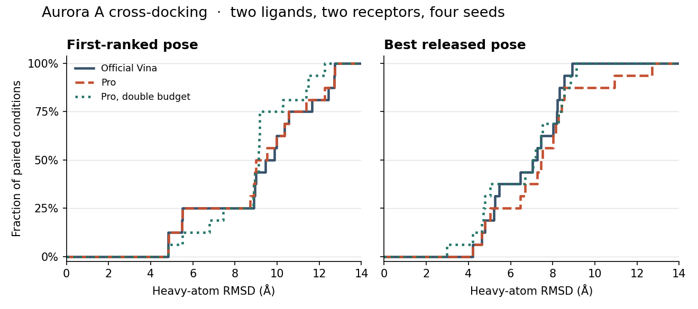

# Aurora A 的初始结合、结合后弛豫与跨受体对接

在同一蛋白上，两个抑制剂可通过很不相同的物理过程达到相近的纳摩尔级宏观亲和力。Pitsawong 等的实验给出了区分这些过程的动力学数据。这里用其公开速率重建结合状态的统计权重，另在两份非查询配体受体上运行三种已冻结的对接设置。在三种药物中，有同靶共晶参照的两种均有较大姿势误差。没有将测得的速率、实验亲和力或晶体姿势用于盲对接。[预测前提交的协议](PROTOCOL.md) · [原始实验，图 3、5、7 与方法](https://doi.org/10.7554/eLife.36656) · [结构误差、全部分位数和独立复算](GEOMETRY.md)

后续在 2X6E 上核实了两条跨缺段伪肽键。三套通过几何检查的模板补环改变了盲搜候选池，固定已有候选则全部保持原赢家。逐池回放、独立晶体供体与远移原子对照见[补环、候选覆盖与条件评分](internal_loops/README.md)。

## 宏观亲和力对应哪些状态

在平衡、单个配体结合、稀溶液且自由配体浓度已知的条件下，令游离受体微态的概率为 $p_s$，配体对微态 $s$ 的初始缔合常数为 $K_{a,s}$。若每个初始复合物还可转为同一受限分支内的另一互斥结合态，定义 $J_s=[RL_s^*]/[RL_s]$。所有计入的结合态必须各自占据不同的统计状态，避免同一终态沿多条路径被累计。按游离受体浓度归一化，得到

$$K_{D,\mathrm{obs}}^{-1}=\sum_s p_s K_{a,s}(1+J_s).$$

$p_s$ 和 $J_s$ 无量纲，$K_a$ 的量纲为浓度的倒数。单分支的结合后弛豫贡献为 $-RT\ln(1+J_s)$。在多个分支上，应先求和再取对数。温度、受体构建体、蛋白修饰及溶液组成需要一致，才能把这个表达式用于定量比较。对从平衡态访问同一终态的环路还要满足详细平衡。该分解给出平衡端点，动力学路径的历时仍需另行计算。

本实验从论文图上的微观速率读数重建。结合步的正向和反向单位分别为 µM⁻¹s⁻¹ 和 s⁻¹，单分子构象变化两方向均为 s⁻¹。独立计算从速率矩阵求稳态，在 0.1、1 和 10 倍重建 $K_D$ 的游离浓度下核对总结合占比，绝对残差均低于 $3\times10^{-14}$。这里检验了代数、符号与单位，速率本身来自原作者拟合，协方差和原始速率的不确定性没有重新估计。[全部速率及图号](rates.csv) · [计算程序](analyze.py) · [逐项结果](results/kinetic_reconstruction.csv)

| 药物与条件 | 仅初始结合，已计入游离态占比 | 加入结合后状态 | WAVE 平衡测量，25 °C |
|---|---:|---:|---:|
| Imatinib，动力学 10 °C | 47,455 nM | 47,455 nM | 24,000 ± 7,000 nM |
| Danusertib，动力学 25 °C | 23,333 nM | 0.872 nM | 1.1 ± 0.4 nM |
| AT9283，按图 7H 的箭头，25 °C | 2.203 nM | 0.359 nM | 2.1 ± 1.8 nM |
| AT9283，统一为图 5I 的游离态占比 | 2.321 nM | 0.503 nM | 同上 |

对 danusertib，从图 5I 得到 $K_{D,\mathrm{encounter|out}}=6.3/0.45=14\,\mu\mathrm{M}$；让 60% 的游离受体处于胜任态后，总体初始结合为 23.33 µM。结合后的速率比 $19/0.00071$ 使最终 $K_D$ 缩小约 26,762 倍，对应 298.15 K 下 −6.04 kcal/mol。独立的溶液平衡荧光滴定为 0.4 ± 0.1 nM。对 AT9283，初始两分支本来就有纳摩尔级亲和力。计入弛豫在图 7H 模型里只再缩小 6.14 倍；与 WAVE 中心值相比，完整模型的偏差反而增大。实测的不确定性、测量方法与构建体差异都需要保留。论文未报告其与 danusertib 同法的溶液平衡荧光滴定。[Danusertib 动力学](https://doi.org/10.7554/eLife.36656.008) · [独立荧光滴定](https://doi.org/10.7554/eLife.36656.009) · [AT9283 动力学](https://doi.org/10.7554/eLife.36656.014)

同一温度的游离态还有一个具体的命名问题。图 5I 及图 5 补充图 2B 给 in→out 0.09、out→in 0.06 s⁻¹，对应 $p_\mathrm{out}=0.60$。图 7H 和图 7 补充图 1A 将状态在图上换位，保留了左右箭头上的数值，按印刷方向得到 $p_\mathrm{out}=0.40$。按各图与其公式计算可恢复作者发表的中心值。若两种药物沿用图 5 的游离态定义，仅修改图 7 的这一处方向、固定其余速率，得到 0.503 nM，相对原重建差 +0.201 kcal/mol。0.60 也依赖构象选择性探针的动力学模型。两次代数计算均未重新拟合实验曲线，不能据此推断原作者软件的实际参数设置。[25 °C 的探针实验](https://doi.org/10.7554/eLife.36656.010) · [AT9283 的分支图](https://doi.org/10.7554/eLife.36656.015)

三份 WAVE 结果采用表面固定、生物素化 T288V 构建体，流动液含 BSA 和 Tween-20；imatinib 另加 5% DMSO。溶液 stopped-flow 测量使用去磷酸化蛋白和 5% DMSO。相同 WAVE 缓冲条件下，danusertib 和 AT9283 的中心值只相差 1.91 倍，图中拟合参数误差范围重叠。预定的三倍可比分子对数为零。未计算这个零分母上的一致率或秩相关。Davis 原始补充表也没有为这三种冻结药物提供同一 AURKA 条件下的追加精确配对。[独立测定核对与逐配体空缺](assay_check/README.md)

## 对接读到了多少信息

2J4Z 与 2X6E 分别由其他配体定义口袋，均复用现成刚性受体和 26 Å 盒。选择中性游离碱单一互变异构态以保持原激酶面板的制备条件，尚无三种化合物在测量条件下的微态权重。特别是 2W1G 的 AT9283 在 CCD 中记录为双质子化，而此处使用中性分子。三个搜索设置始终看到相同分子、受体和分子起点。每个受体与配体使用四枚固定种子，一条命令启动两条轨迹。原生 Pro 的四种子首姿分数中位数如下。

| 受体 | Danusertib | AT9283 | Imatinib | AT9283 − danusertib |
|---|---:|---:|---:|---:|
| 2J4Z | −8.027 | −8.297 | −8.874 | −0.270 |
| 2X6E | −8.689 | −7.685 | −8.089 | +1.005 |

对接给两个纳摩尔级药物的排序依赖受体结构。两种药物的实验也不足以可靠区分强弱。2J4Z 给 imatinib 最高的预测亲和力，而它在带 DMSO 的 WAVE 测量中明显较弱。温度与溶剂差异排除了用这两个跨条件对为模型计分。不能从经验分差倒推弛豫自由能，也不能仅凭某次选姿或某个晶体状态判定激酶在溶液中的占比。[全部种子与计时](results/runs.csv) · [逐受体分差](results/differences.csv)



官方 Vina、Pro、双预算 Pro 的 24 次进程墙钟合计分别为 38.22、10.12、14.13 秒，CPU 合计 38.13、9.98、14.02 秒，分别输出 215、214、214 个模式。常规和双预算 Pro 的 hunt、second 与显式精修日志合计分别为 1,214,088、2,413,806 次已报告的求值。单次基准是在共享机器上交错运行，二进制、编译选项、候选保留和精修实现均有差异。官方二进制未暴露同口径求值计数，精确相等的是两臂配置的搜索上限。新构建的 AD4 修正版上重新执行了完整的 72 次命令，所有输出姿势和所有预处理输入逐字节相同。在这次复现中，从已有归档提取受体和制备三个配体耗时约 4.05 秒，72 次对接连同写入结果清单约 63.0 秒，两个结构评价及动力学/评分复算合计约 2.50 秒。现成受体最初的建模、本地编译和文献的动力学实验不包含在这些时间内。[首轮计时和计数](results/costs.csv) · [修正版独立运行](results/clean_replay.json)

在以上结果冻结后，另用共晶位置和原输入的实际扭转树构造近晶体见证。两种配体均能进入 0.62 Å 以内。在 2J4Z 上，两者与蛋白质均有小于 1.83 Å 的重原子短接触，常规精修后 RMSD 都升到 2.3 Å 以上。在 2X6E 上，两个见证精修后均在 1.6 Å 内，按固定零点重评却只胜过八个盲搜首姿中的一个。同一套资料可以区分局部几何兼容性、优化停滞和干分的错序。这些含答案坐标的结果单独归档。[逐格接触、原子图对照、局优目标及全部原始输出](PROBE.md)

默认 BFGS 后续修复的实测效应已另存。下列主研究复现命令和上表均使用其注明的冻结版本。[新旧引擎的逐病例重跑](solver_replay/README.md)

## 复现

Python 3.12、RDKit 2026.09.2、Meeko 0.8.0、Gemmi、NumPy、SciPy 与 Matplotlib。对接主分析的生产源码为 400d57d，修正版复核为 7bc6128。官方二进制 SHA-256 固定在程序中，两个本地二进制哈希分别留在首轮和复核的结果中。所有参考 PDB 与 CCD 均有来源及 SHA-256。配置与制备分子不读取共晶文件。以下命令从仓库根目录执行。[参照来源与校验和](results/reference_sources.json) · [受体建模和已知缺失原子](../../torsion_kinase_affinity/README.md)

```sh
D=benchmarks/receptor_linkage/aurora
K=benchmarks/torsion_kinase_affinity/evidence.tar.xz
W=$(mktemp -d)
mkdir "$W/dock" "$W/ref" "$W/eval"
tar xf "$D/docking.tar.xz" -C "$W/dock"
tar xf "$D/references.tar.xz" -C "$W/ref"
python "$D/analyze.py" "$W/dock" "$W/eval"
python "$D/geometry.py" "$W/dock" "$W/ref" "$W/eval" --kinase-archive "$K"
python "$D/frame_check.py" "$W/dock" "$W/ref" "$W/eval" --kinase-archive "$K"
cmp "$W/eval/geometry_modes.csv" "$D/results/geometry_modes.csv"
python "$D/dock.py" prepare "$W/rerun"
python "$D/dock.py" run "$W/rerun" "$PRO_BINARY" "$OFFICIAL_127_BINARY"
python "$D/analyze.py" "$W/rerun" "$W/independent"
cmp "$W/independent/scores.csv" "$D/results/scores.csv"
```
