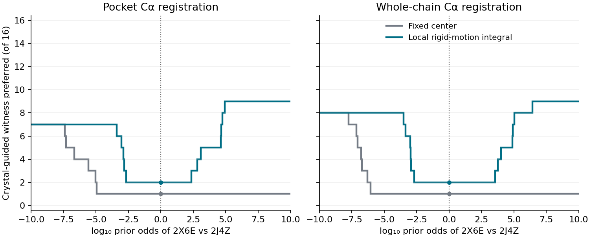

# 两种受体构象和姿势的局部活动空间能解释 Aurora A 的错排吗？

在预定的 16 次二选一中，为两种实验受体赋相同权重时，固定中心选中更接近晶体的姿势 1 次，加入局部刚体积分后选中 2 次。即使给定全部答案，允许对所有病例共同选择一个最有利的受体占比，积分后的上限也只有 9/16。两个模型都保留了明显错排。[方案](PROTOCOL.md) · [逐配体、受体与随机种子结果](results/pairs.csv)

## 在同一坐标和参考上组合自由度

令 $s$ 表示受体，$i$ 表示一个给定分子的候选。将整套配体坐标放入受体 $s$，在零未结合态偏移下重算原生中心分 $S_s(i)=a_L(E_{inter}+E_{intra})$，其中 $a_L$ 是该配体原生转子归一化斜率。每次把同一姿势的所有原子一起变换。相同内部坐标在物理上具有相同的内能；三位小数 PDBQT 重写后，实测跨配准的原始内能最大波动 0.007 分。不同候选的内部能量仍计入相对分数。AT9283 全程锁定原 SDF 的完整环丙基图。

沿用既有刚体窗，在半径 1 Å 的平移球和 15° 的旋转球中积分。旋转采用 Haar 测度，平移、旋转测度均在窗内归一。记 $g$ 为该平移和转动，$RT=0.5925$ kcal/mol（298.15 K），规定 1 个 Vina 分数单位按其名义能量刻度换算。对两个受体先分别积分，再以一个共同的游离态权重混合：

$$
I_s(i)=\int_W e^{-S_s(gi)/RT}\,d\nu(g),\qquad
F_p(i)=-RT\ln\big[(1-p)I_{2J4Z}(i)+pI_{2X6E}(i)\big].
$$

点模型将 $I_s$ 换为 $\exp[-S_s(i)/RT]$。这是在同一受体和坐标变量上计算的联合期望。受体改变同一旋转的接触能，因此先平均分数再算统一的“活动空间补偿”一般会产生不同的结果。此处复用原生经验分数，受体各有一个固定结构，水和离子无显式响应，配体转子、环和微态被冻结。两种受体来自含其他配体的晶体，溶液中各态权重未知。不同候选的局部窗也没有覆盖或划分完整构象空间。这一函数用于同分子、同输入图的成对选姿。获得标准态结合常数需要完整结合与游离系综和空间标准化。[原生评分定义](https://doi.org/10.1002/jcc.21334) · [原有窗和重要性积分](../../../rigid_window/README.md) · [统计力学推导](https://doi.org/10.1016/S0006-3495(97)78756-3) · [限制与释放受体构象的热力学循环](https://pubmed.ncbi.nlm.nih.gov/18843379/)

对一对晶体引导见证 $n$ 和盲搜首姿 $d$，定义 $D_s=I_s(n)-I_s(d)$。选中见证的严格条件为 $(1-p)D_{2J4Z}+pD_{2X6E}>0$。两端同为负时，任何占比都不能改变这一对的选择；两端异号时只有一个交点。将所有交点按对数优势 $\ln[p/(1-p)]$ 排序即可穷尽全部可能的共同排序。对一个受体的所有姿势和配体加一个共同能量常数，相当于平移对数优势轴，因而共同占比的最优计数对这样的标定偏移不变。等权混合的数字和最优区间所对应的物理占比都依赖能量零点。

## 固定池、配准和数值核验

每个来源受体、每个配体用同一合法扭转放置经 5015481 局优得到一个晶体引导见证，另用同来源受体四枚种子、25k 档的全部 Pro 首姿。四个见证的对称重原子 RMSD 为 0.612–2.963 Å，16 个盲搜首姿为 6.836–14.041 Å，每对见证都比其对照近。两种配体、两个受体出现多次。2J4Z 上 AT9283 的四个盲搜首姿互相只差 0.150–0.443 Å。主配准按 60 个共同口袋 Cα（0.800 Å），敏感性复算用 249 个全链共同 Cα（2.708 Å）。没有在接收受体上重优化或按晶体姿势再拟合配体。[源盲搜与实验参照](../GEOMETRY.md) · [见证构造](../PROBE.md) · [全部中心与连续结构误差](results/centers.csv)

| 配准与模型，每尺度 65,536 点 | 各在来源受体选姿 | 两受体 1:1 | 标签已知、全部配对共用最优占比 | 标签已知、每对自选占比 |
|---|---:|---:|---:|---:|
| 口袋 Cα，点分 | 1/16 | 1/16 | 7/16 | 9/16 |
| 口袋 Cα，局部积分 | 2/16 | 2/16 | 9/16 | 14/16 |
| 全链 Cα，点分 | 1/16 | 1/16 | 8/16 | 10/16 |
| 全链 Cα，局部积分 | 2/16 | 2/16 | 9/16 | 15/16 |



口袋积分的 9 次只在近乎纯 2X6E 的极限达到，要求 $\ln[p/(1-p)]>11.348$，即 $p>0.999988$（含纯态端点）。点模型的最优端却接近纯 2J4Z。图中画出对数优势 −10 至 +10（以 10 为底），更极端的交点和两个纯态端点均纳入表中穷举。每对单独选占比相当于为相同游离受体赋予互不相容的解。真实溶液占比及罕见状态的可信度都无法由这些标签决定。[各数值密度的解析区间](results/bounds.csv)

一个在配准变化后仍保留的反例是 2J4Z/danusertib/60913。见证与盲首姿分别为 2.963、10.842 Å。局部积分给盲首姿的领先量在来源受体为 2.404，在另一个受体按口袋对齐为 0.442、按全链对齐为 1.600。两个状态均偏向更差的姿势。对 2X6E/AT9283/60913 则不同：在来源受体，1.266 Å 的见证输给 6.836 Å 的首姿约 0.383 分；将两者转入 2J4Z，按口袋对齐仍输，按全链对齐时交换次序。后一个例子的“任何权重都无解”依赖坐标注册。

在等权的、含答案见证的二选一池上，口袋点模型和积分模型的首姿 RMSD 均值分别为 8.675、8.324 Å，中位数均为 9.072 Å，P90/P95 均为 10.629/11.642 Å。两者平均 regret 为 7.072、6.720 Å，配对 Oracle 为 1.603 Å。原盲搜首姿均值 9.031 Å。引入了晶体引导坐标，因此上述数值只刻画已给定两个候选时模型的识别能力。[各分位数、逐格差值与完整数据](results/conditional_geometry.csv)

## 收敛与复现

主协议 2,048 → 8,192 点时，口袋积分的共同上限从 10 降到 9，逐对上限从 15 降到 14。为检查这一变化，追加每尺度 32,768 与 65,536 点，不改坐标、积分域、权重定义或实验分母。较高三档两类上限一致；最末两档的个别跨受体窗口仍相差 0.898 个能量单位，最低有效加权点数仅 1.73/196,608。狭窄区域中的少数姿势主导积分，稳定的汇总计数不等于逐姿窗口自由能已经收敛。独立路径由 Gemmi 重新配准，独立检查化学图对称映射、普通 score_only 读数以及九十位十进制的排序区间。240 条状态/密度结果重建一致。主运行 4 次来源局优、19,537,920 个积分节点，约 141 s 墙钟、141 s CPU；成本从解包固定输入计至写出状态结果，不含原始制备、历史盲搜和独立复核。[收敛与独立复算](results/verification.json) · [成本与输入散列](results/cost.json) · [所有状态的积分数据](results/state_scores.csv) · [实际使用的坐标与局优日志](coordinates.tar.xz)

从仓库根目录执行。BIN 指向 5015481 的生产二进制，W 指向新目录。软件依赖 Python 3.12、RDKit、Gemmi、NumPy、SciPy；绘图另需 Matplotlib。只复算上界时，可直接把 results 中的 state_scores.csv 和 centers.csv 放入新目录，运行 analyze.py。

```bash
D=benchmarks/receptor_linkage/aurora/state_windows
OPENBLAS_NUM_THREADS=1 python "$D/replay.py" "$BIN" "$W/input" "$W/results"
python "$D/analyze.py" "$W/results"
OPENBLAS_NUM_THREADS=1 python "$D/verify.py" "$BIN" "$W/independent" "$W/results"
cmp "$W/results/pairs.csv" "$D/results/pairs.csv"
```
