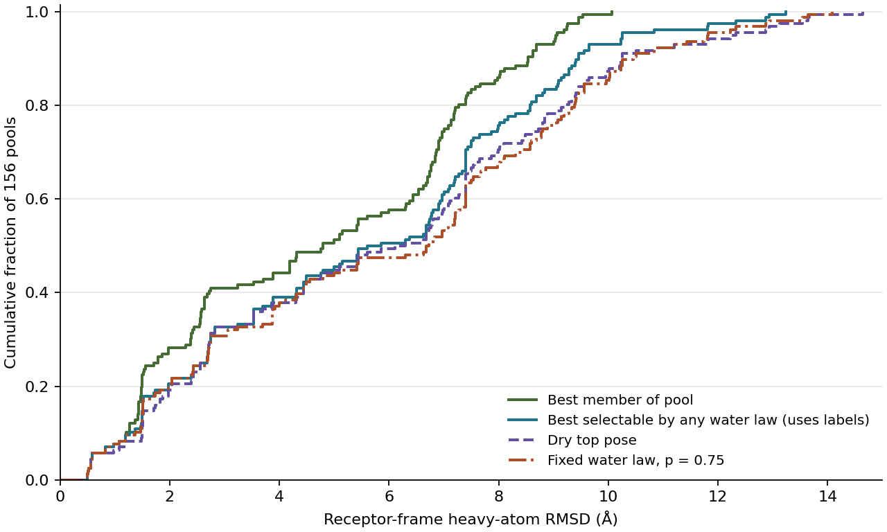

# 即使知道晶体，任意水位点占据率能将哪一个姿势选为第一？

在7个人源靶点的156个交叉对接池中，82个池里的最接近晶体姿势，在既有干分和几何水模型下不可能排第一。允许每个池单独挑选最有利的全部位点联合分布，包括改变每个边际占据率并引入任意相关性，得到的最佳首姿均值为 **5.506 Å**。相同池中直接取最接近晶体的模式可达 **4.679 Å**。这里的差额 0.827 Å 是既有坐标和模型能表达的排序范围所决定的。它不估计真实水所贡献的能量，也不能转化成预测时的校正量。[事前登记](PROTOCOL.md) · [可行分布与积分阶数](SENSITIVITY.md) · [未决池的穷举登记](MIXTURES.md) · [156池全部结果，两阶各一行](results/classified_pools.csv.gz)

## 物理上究竟放宽了什么

重算使用原始 PDB 受体水氧、B 因子、受体排斥、固定取向无关的配体几何可容纳比例和发布干分。令 $a_{xi}$ 表示姿势 $x$ 下位点 $i$ 的可容纳比例。离散的占据向量 $n$ 取 0 或 1。给每个配置一个共同的受体参考概率 $q_n$，固定同一池中各姿势共用它。每个姿势的相对权重为

$$
 w_x(q)=e^{-E_x/(RT)}\sum_n q_n \prod_{i:n_i=1} a_{xi}.
$$

取 $R=0.00198720425864083$ kcal mol⁻¹ K⁻¹、$T=298.15$ K，干分沿用经验打分的 kcal/mol 数值约定。历史模型给每一位点概率 0.75、假设位点独立。若空配置的概率为 1，就恢复干分排名。对 $a_{xi}=1$ 的位点，无论它是否有水都不改变该姿势的核。水的取向、配体特异的水–水与水–蛋白结构重排、游离配体溶液参考在本模型中没有独立观测量。两个积分阶数检验有限几何积分的敏感性。真正的结合自由能要求在同一 Hamiltonian 与水化学势下对各相积分；2D-GCAP 等方法同时处理配体炼金变换和水网络变化，可供另一个物理实验对照。[既有核与限定边际的研究](../mechanism_interactions/water_correlations/README.md) · [Bruce Macdonald 等的 2D-GCAP](https://doi.org/10.1021/acs.jctc.8b00614)

### 单一对手与多个对手是两种情形

若姿势 $x$ 与 $y$ 的位点可容纳比例都大于零，在任意配置下让 $x$ 相对 $y$ 权重最大的取法是只占据 $a_{xi}>a_{yi}$ 的位点。因而 $x$ 相对 $y$ 的有效分数差下界为

$$
 E_x-E_y-RT\sum_i\max\{0,\ln a_{xi}-\ln a_{yi}\}.
$$

若该下界大于 0.001 kcal/mol 再加 $10^{-9}$ 数值容差，哪怕把三位小数的两份干分向目标最有利的方向舍入，$x$ 都输给 $y$。对每个水配置成立的不等式，在任意非负混合后仍成立。实现显式区分零支持。实测两阶最小正可容纳比例分别为 $4.10\times10^{-8}$、$3.90\times10^{-8}$，此次数据没有精确为零的位点核。[闭式与896个枚举检查](envelope.py)

对其余候选，一个姿势可能单独对每个对手有取胜的占据方式，却找不到能同时战胜所有对手的共同 $q$。在尚未闭合的池中，9–13 个位点容许枚举所有配置。对每列权重用该列最大值归一化；每列都是非负向量，归一化前后可实现的排名相同，混合系数按列尺度反变换即可还原真实 $q$。最大化目标相对各对手的最小权重差。可行的 $q$ 证明能选中；对偶分布把若干对手做凸组合，若连该组合在每种配置下都胜过目标，就证明目标必定输给至少一个对手。对原始 $q$、全部对手及全状态重算，分别用有利和不利的舍入端点。55 份双边界检查用独立线性乘积复算，归一化余量最大差 $2.01\times10^{-15}$。[优化程序](mixtures.py) · [原始分布与对偶证书](results/game_witnesses.json) · [独立验证](results/independent_game.json)

## 哪些姿势仍有机会

| 七靶点156池，受体框架 RMSD（Å） | 均值 | Q1 | 中位 | Q3 | P90 | P95 |
|---|---:|---:|---:|---:|---:|---:|
| 已发布干分第一名 | 5.875 | 2.649 | 6.204 | 8.747 | 10.241 | 12.254 |
| 既有独立占据水模型第一名 | 5.957 | 2.686 | 6.707 | 8.825 | 10.353 | 11.813 |
| 给每池晶体标签和最优共同水分布 | 5.506 | 2.649 | 5.735 | 7.978 | 9.435 | 10.254 |
| 在同一候选池直接挑几何最佳者 | 4.679 | 1.766 | 4.801 | 7.028 | 8.535 | 9.050 |



首轮11点积分有1,217/1,557个模式已有单一更优对手。77个池的几何最佳者由此直接排除。148个池靠一个具体配置就已闭合可达精度上下界。在其余8个池中，穷尽全部配置及其混合后又排除了5个池的几何最佳者；所有池的可达误差均确定。17点积分的单一对手证书对应76个池，加入共同分布约束后逐池最佳误差完全复现。对两个积分阶数分别成立的结论仅涉及这些已离散的核。

| 靶点 | 池数 | 任意共同水分布也选不中几何最佳者 | 干首均值 | 水首均值 | 该模型可达最优均值 | 池几何最优均值 |
|---|---:|---:|---:|---:|---:|---:|
| BACE1 | 24 | 10 | 9.904 | 9.915 | 8.226 | 7.335 |
| BRD9 | 24 | 15 | 5.415 | 5.807 | 5.103 | 4.541 |
| CHEK1 | 24 | 15 | 6.917 | 6.808 | 6.806 | 5.482 |
| EPHX2 | 24 | 16 | 4.785 | 4.785 | 4.785 | 3.259 |
| ESR1 | 20 | 8 | 1.826 | 1.826 | 1.826 | 1.502 |
| PDE4D | 20 | 4 | 4.323 | 4.371 | 4.010 | 3.847 |
| PPARG | 20 | 14 | 7.254 | 7.490 | 7.206 | 6.406 |

12个池没有入选水位点。限制到其余144个池，仍有75个池无法选中几何最佳者。历史三靶点面板为26/60，迁移四靶点面板为56/96。相同受体、化合物、嵌套预算和种子重复使用；这些是按登记池计数的确定性结果。

同一组 BACE1 输入和 seed 43117 就有两种结局。配体 2ZJM 对受体 2B8L，软搜索 12k 池从干首 13.131 Å 切换到池最佳 3.885 Å。相同软搜索的 3k 池含6.857 Å候选，干首 12.940 Å，即使给全部21个位点任意占据分布，能选中的最佳误差仍是12.940 Å。CHEK1 的 2YWP→2E9P、3k 软搜索、seed 43133，池最佳1.861 Å，单一对手界限只能推到2.584 Å，而共同分布的精确界限升为8.576 Å。由这些坐标可以排除仅修改占据概率的充分性，仍不能在干分偏差、水几何核、受体弛豫、实验参照等解释中唯一归因。[逐格](results/classified_pools.csv.gz) · [共同分布裁决](results/game_pools.csv)

## 复算、成本及边界

在仓库根目录执行，运行时从已提交归档解压。读入的模式与干分、位点数、原水分数及赢家均逐项匹配；原水分数最大差为 $8.89\times10^{-16}$。另用旧面板的受体配准、化学映射和原始 PDBQT 重新生成完整 poses.csv，SHA-256 为 22dc9e4ae923c90df0793f7ac26618f949c00443132c3265619e0ddfdb68679e，与原表逐字节一致。核表保留完整可容纳比例，逐池表保留来源文件 SHA-256。首遍数值研究耗费 19.92 墙秒 / 19.89 CPU 秒，包括两阶坐标积分、成对界限和结果写出。未决池全状态优化另用 2.31 / 2.34 秒，独立证书重算 0.49 / 0.49 秒。旧面板已付出的对接成本另见父研究。首次写出联合分布见证时，NumPy 整数不能直接转 JSON；改为原生整数后按同一登记全量重算，未变更求解或纳入规则。[环境、输入散列和计时](results/manifest.json) · [原始对接与成本](../soft_water_interaction/README.md)

```bash
D=benchmarks/water_rank_envelope
W=$(mktemp -d)
export OPENBLAS_NUM_THREADS=1
python "$D/study.py" "$W"
python "$D/mixtures.py" "$W" "$W"
python "$D/verify_game.py" "$W" "$W/independent_game.json"
python "$D/summarize.py" "$W"
```

评估域仅包含已发布的冻结池。历史强弱改变来自姿势排名和候选池相互作用。没有从 MC 访问频数或拟合的 $q$ 得到可用于新配体的真实水占据率，也没有本方法产生的预测性 Ki/Kd 或自由能。
