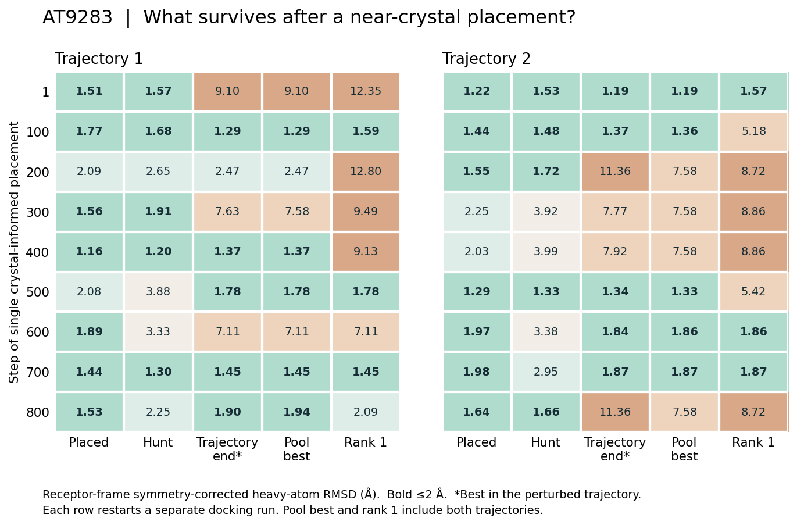

# 从同一结合系综推导姿势和亲和力：FastDock 的证据与边界

早期研究以 `3f21e02` 为基线，用两个可以直接否证的命题区分调权不足和表达能力不足：在同一批坐标上，已知正确几何后，已有干分和水或 CH–π 分项能否选中它？给同一测定的所有配体一个共同的游离受体分布，已有状态分数能否解释实测强弱？前者在 344 个历史池中的 149 个得到否定；后者在 Gal3 的 403 个三倍分离对中，给两份现有结构任意共同占比也最多判对 146 对。[固定池判定](../benchmarks/mechanism_interactions/attainability/README.md) · [逐测定上界](../benchmarks/mechanism_interactions/shared_population/README.md)

## 同一个已发布的近晶体姿势为何仍输给错姿

在来自其他配体共晶的两份人 AChE 结构中，原生盲搜对石杉碱甲的表现相差显著。4EY6 的三种引擎/预算、三枚种子中，4/9 池将 ≤2 Å 的姿势排第一；4EY7 包括替代盒心的 12 个池均未发布 ≤2 Å 的姿势。对同一枚种子追踪每一步：4EY6 有 731/2431 个近提议，4EY7 仅 1/2828，后者从 1.990 Å 经第一次局优移到 2.288 Å。由另一个受体的盲搜和仅用两份受体的配准，4EY7 实际可得到距晶体 0.550 Å 的局优端点。它通过去重并发布为第七，原生干分 −7.355，高于 5.744 Å 首位的 −9.313。跨受体生成改善了该池覆盖，未改善首位；六个交叉条件的首位相对同受体双种子反而平均增加 0.883 Å。已将提议、局优和终排的责任定位到具体坐标及真正执行的路径。数值属于同一配体在不同受体状态中的条件干分；水、配体微态及受体游离态占比仍待独立输入。[完整实验与原始下载](../benchmarks/ache_receptor_state/README.md)

## 水分布的表达能力、真实局优与配体内部参考

七种蛋白、156 个固定池的 1,557 个发布模式，干首、水独立占据首位、允许各池按晶体选择最有利的任意联合水占据分布、直接选池几何最佳者的平均误差依次为 **5.875、5.957、5.506、4.679 Å**。82 个池没有任何一种共同水分布能让几何最佳者成为首位，含有入选位点的池仍为 75/144。11 与 17 点每轴积分给出相同的逐池可达误差。任意一次水构型决定整个池的权重向量；未知占据只能选择这些向量的非负混合。即使每个对手都能分别战胜，多对手也可能要求互不相容的水分布。该证书保留已存干分、位点与位置积分，各靶点特异水化的物理原因仍需独立数据。[数学、按靶点分布和上下界](../benchmarks/water_rank_envelope/README.md)

在七靶点之外，新取人 AChE 的 4EY5 配体 HUP，对接到另一晶体的 4EY6 A 链已知口袋。普通 Pro 24k 的首姿与池最佳均为 3.623 Å；同种子 48k 的池仍含 3.623 Å，但其首姿为 4.562 Å；官方 Vina 1.2.7 的首姿为 4.563 Å，排名第四的 3.259 Å 为池最佳。用每池全部 33 个受体水位点，在两阶积分都能证明每种联合占据规律仅可能选出原第一名。外检新增配体及共晶，此受体曾用于其他机制研究。该体系统一使用 CCD 净电荷 0；单配体、单种子和固定的受体/配体化学态仅能提供这一格的对照。[外检输入、原始发布和实耗](../benchmarks/water_rank_envelope/transfer/README.md)

在两个独立登记的历史面板中，对 1,537 个发布姿势与 234 个搜索阶段坐标作化学对称校正，将受体框架平方误差分成质心位移、允许正旋转后的内部形状下界和其余定向误差。同一状态由 hunt 进入第二次局优，覆盖面板 15/30、片段面板 25/48 次至少有一个分量下降、另一个分量上升。对于整池最近姿势仍超过 5 Å 的 11、46 个池，均可从已保存形状找出刚体叠合到 2 Å 内的例子；实际对受体查询最近距离后，在这些最优叠合的有限集合中，还能满足跨分子重原子距离均至少 2 Å 的池分别为 0、22。前一组全为 A1120 羧酸的相关重复。这里的刚体叠合看到了晶体答案，不能直接用于盲搜。[逐阶段坐标、无碰撞门的距离与刚体变换](../benchmarks/pose_error_geometry/README.md)

FKBP12 的 Holt 同测定给出 5、6 号表观 Ki 为 110、12 nM。给 6 号的首姿去掉三个甲氧基并恢复 5 号全部电荷和类型后，可以将两个原发布分数差写成固定位置的化学替换与 5 号的两种位置差。改用 5 号真实扭转树构造中间态，26 个重复条件中的 9 个改了取代项符号。两份独立制备的六元哌啶环形状相差 0.536 Å，保持所有片段刚性、允许解开片段间连接后，已足以证明整配体中间几何的 RMSD 至少约 0.296 Å。真实树上的可行近似中位 0.396 Å。在 59 个不同受体/坐标输入调用当前 Pro 的原生 AD4 局优后，26 格中的有利取代项由 17 降至 11，5/6 两端强弱方向没有一格翻转。所有回放采用同一 Pro 算子；图对应、目标调用、两端发布分、数值误差与成本均可分别核对。该分解对选择的中间态敏感。同一实验分子对不能独立标定两个分项，也不能给出溶液参考。[同骨架分解](../benchmarks/affinity_conditioning/README.md) · [可达构象与下界](../benchmarks/affinity_conditioning/MANIFOLD.md) · [原生局优、逐格结果与成本](../benchmarks/affinity_conditioning/REFINE_RESULTS.md)

## 同一源态的全分子位移覆盖与结合盆地

同一冻结内部构象用全重原子均方位移比较两个刚体变换，质心平移与坐标二阶矩给出精确的有限维表达。把每个合法腔点对应到所保留候选的最大间距降下来，只能给晶体误差上界加一个覆盖半径。它没有给可结合区域的测度。16 个历史源态中，盒内边长门和最远点门的平均最大间距为 8.075 与 3.257 Å，保有 ≤2 Å 候选却从 5 格降为 3 格。在新的六格，相同的三点源态、场与唯一 hunt 下，原边长、覆盖、均匀首位为 1.208、1.201、1.212 Å，覆盖的六个注入 ID 全部逐出。非线性的筛选、松弛与重新发现足以同时产生正、负和接近零的结构变化。由首位差不能唯一识别缺失的微观物理项。FKBP12 三种门都判对同测定的 10/15 对；组内错误集中在缺少可核对晶体结构的化合物 6。预测性自由能仍需独立的统计权重与两相参考。[推导、原始候选、实测成本及逐对结果](../benchmarks/rigid_pose_coverage/README.md)

## 改用单个刚性片段定位完整配体

在完全相同的原生源态上，整分子、刚性片段和片段取向打乱共享 1,024 项预算、真实类型粗排和唯一 hunt 名额。16 格实际发布首位依次为 5.653、6.759、5.851 Å；池 Oracle 为 4.800、5.891、4.783 Å。三项预指定漏例的门后最低误差均下降，0/3 新跨过 2 Å；两种原来覆盖的实例失去了近姿。全对应与边长截取的区别可在配对微态上直接观察，A1120–93241 阴离子的片段库第一近姿在边长第 10875 名，中性酸同一锚点方法连穷尽也只到 2.372 Å。BRD9 的两个新知情分叉在第 2 步逐出原 ID，随后都获得约 1 Å 的首位。测定中整分子/片段/打乱的三倍方向为 7/15、9/15、10/15；片段姿势实耗为普通 Pro 的 2.64 倍墙钟、2.67 倍 CPU。默认仍用普通 Pro，自由能误差没有新增估计。[事前方案、方法、真实发布及复算](../benchmarks/fragment_anchor/)

## 固定重原子候选库后，原生场识别到了什么？

在 BRD9 两个冻结的 1,024 项 matched 库中，原形状、真实 XS 类型场、等计数的类型置换找到的第一份 ≤2 Å 候选分列 8/2/3、34/12/15。真实类型两次均错过唯一的 hunt 名额。按[事后分叉协议](../benchmarks/cavity_field_rank/audit/FORK_PROTOCOL.md)把两份已知近姿单独送入原生 hunt，分别达 1.113/1.852 Å，实际发布首位 1.162/1.098 Å。两次直接注入的 ID 都在第 2 步逐出。真实类型盲臂第二个种子的 1.140 Å 首位同样来自之后的轨迹。就该刚体快照而言，真实类型提供了小幅的额外提前量，两种原子场共同带来的排名提升更大。[分数、坐标和谱系](../benchmarks/cavity_field_rank/)

移除空间格点、在同坐标用原生径向距离表直接对受体重原子求和，20 个库/类型臂有 19 个胜者不变。两个 BRD9 真场库的第一近姿位置变为 2、14，两份可捕获的初态均无小于 2 Å 的重原子穿插；它们实际 hunt 后的目标值也都高于当次盲胜者。固定哈密顿量与优化器下的这些配对差异不能拆出溶剂熵、受体重排或结合概率。[原子对复核](../benchmarks/cavity_field_rank/audit/README.md)

十格 Vina 姿势库的 2 Å 生成覆盖为 3/10，保留的质心和取向任意重配可达 6/10，固定内部形状任意刚体配准可达 9/10。在真实/置换中，十格发布首位均值 6.651/6.038 Å，池 Oracle 5.630/4.974 Å。同测定八个 FKBP12 配体在真实、置换中都从形状的 7/15 降至 5/15。刚体场读取、局优进入盆地、候选存活和两受体等权亲和力排序对应不同的可观测量。单核一遍实现的真实场十格耗时 6.992 墙秒，普通 Pro 为 2.768 秒。保留默认搜索；本轮未估计预测性结合自由能。[生成下界](../benchmarks/cavity_field_rank/audit/results/representation.csv) · [同测定结果](../benchmarks/cavity_field_rank/fkbp/README.md) · [在线成本](../benchmarks/cavity_field_rank/engine/README.md)

## 空腔三点识别了哪些位置，哪些位置真正发布了？

BRD9 82I 的两枚新种子提供了可以逐坐标定位的例子。在原轨迹的第一个提议上，保持所有扭角，将三个配体点对应到普通受体的三个腔点。两个 1,024 候选库的最低 RMSD 为 0.773、0.963 Å；按无原子类型的最近邻形状分取一名时，实际送进 hunt 的却是 11.933、12.296 Å。分别将两臂库里按原粗分最靠前的 ≤2 Å 候选送入完全相同的搜索，四个有标签分叉中三个最终发布 ≤2 Å 首姿，一个池最近只到 2.570 Å。两条成功分叉在第 2 与第 4 步已逐出最初注入的候选，后续重新找到近姿。原始 ID 的存活和后续几何捕获因此可以独立度量。[盲预测、真轨迹和分叉](../benchmarks/cavity_triplet/README.md)

AT9283 的开发集有不同的限制。在按步号预取的 18 个构象中，14 个可以用理想刚体运动进入 2 Å；固定这批腔点和所选配体三角，每个构象穷尽 29,754 个合法对应均未进入 2 Å。若阈值放宽到 3 Å，11 个构象有可行对应，全部被三边残差前 1,024 的预筛删去。再将入选的每一个质心和每一个转动任意重配，13 个构象可入 3 Å，仍无一能入 2 Å。刚体平移和取向的这两个条件来自受体框架 RMSD 的平方分解，可在原始坐标上计算。[逐构象可达界限](../benchmarks/cavity_triplet/results/geometry_limit.csv)

新六格完整图 Pro、几何匹配、取向打乱的平均 Top‑1 分别为 9.121、8.665、8.357 Å，发布池 Oracle 为 8.152、7.809、6.776 Å。FKBP12 两张受体图的八个分子重算相同测定，三倍方向分别为 7/15、7/15、6/15。增加提议的空间范围产生了不同候选，尚未看到完整对应带来可推广的端到端预测优势。独立计算的 Davis 六格闭合交换差为 −8.580232 kcal/mol，来自已知测定。本轮没有新的结合/游离两相采样。[配对预测和成本](../benchmarks/cavity_triplet/README.md) · [FKBP 逐分子、悬崖和两种受体的相反响应](../benchmarks/cavity_triplet/fkbp/README.md)

另在三个羧酸的同配体、同受体、相同制备重原子坐标上对照 HA 与 A⁻。六格中匹配的平均 Top‑1 / 发布池 Oracle 为 3.586 / 3.076 Å，优于同批打乱的 4.865 / 4.045 Å。RBP4 的 A1120 给出相反方向的实例：HA 的匹配 / 打乱 Oracle 为 2.289 / 8.635 Å，A⁻ 为 8.645 / 2.292 Å。去氢会同时改变供氢、类型、电荷与一个自由扭转，模型没有估计实际结合时两种状态的比例。[两微态追加验证](../benchmarks/cavity_triplet/acid_pair/README.md)

## 将同一内部构象放回完整图，近晶体姿势在哪一步丢失？

在 AT9283 对 2X6E 加 1OL7 撤约束环、种子 61231 的原轨迹上，按步号预取 18 个真实提议。保持内部扭角和受体场，对原位、单独平移、单独校正取向做原生 hunt，三组均为 0/18 返回 3 Å 内。用独立共晶同时校正质心和取向，14/18 起点进入 2 Å，10/18 经 hunt 仍在其中。分别只改动一次、接着跑完剩余原生 MC 和发布流程，最终 10/18 个池含 ≤2 Å 模式，6/18 首位达到该水平。其中四条在首次 hunt 后还处于 2 Å 外，靠后续步骤重新进入。受体框架内的这些反事实只回答被放到该处会发生什么。[事前方案](../benchmarks/receptor_linkage/aurora/internal_loops/rigid_coupled/PROTOCOL.md) · [418 次同构象对照、18 次单步分叉和逐坐标复核](../benchmarks/receptor_linkage/aurora/internal_loops/rigid_capture/README.md)

图中每行是一轮独立运行，绿色粗体表示 ≤2 Å。轨迹 1 在第 1 步得到 1.568 Å，经第二次局优以 1.582 Å 入池，该轨迹在第 136 步仍保有 1.566 Å 的末个近姿。第 137 步九格已满，一份 10.503 Å 的错姿以 −5.601 的经验分逐出 −3.579 的近姿。两者引擎顺序 RMSD 为 10.312 Å，超过 1 Å 去重阈值；此后到轨迹末其常驻池最近只剩 9.098 Å。同一轨迹第 400 步的分叉最终发布了 1.366 Å 的候选，却将 9.127 Å 排第一。在同时校正后的 18 个起点中，7 个至少有一对受体–配体重原子距离 <2 Å，其中 4 个经局优仍能达到 2 Å RMSD；另外 11 个起点没有这种短接触，其中 5 个也没能在该阈值内返回。局部穿插、局优、有限池和排名都可以直接分开检验。静态干受体未模拟文献实测的 DFG 构象变化和结合后弛豫。[Aurora A 停流动力学与晶体实验](https://doi.org/10.7554/eLife.36656)

真实盲搜用随机配体重原子当枢轴，把原平移换成一次保持相同整分子均方根位移的旋转。此举只需正常输入。对 12 对首次分叉，平均整分子位移均为 1.788 Å，质心位移从 1.788 降至 1.239 Å。回查两种配体五枚旧完整图种子，17,332 个变异前父状态全部距晶体 >4 Å；一次整体位移 ≤2 Å 的变换没有任何一次能直接将这些父状态移到 2 Å 内。多步轨迹与后续柔性局优仍可能跨越更大距离。独立新种子下，Pro→枢轴的六池平均首姿 9.431→9.588 Å，Oracle 8.162→8.390 Å，首姿 P95 12.875→13.282 Å；真实梯度类求值 301,535→301,301。AT9283 两池 Oracle 小幅降低，danusertib 在种子 81373 的 Oracle 由 12.680 升至 14.495 Å。采用相同随机抽数的平移对照在这一格为 7.481 Å。保留默认 Pro。[盲搜全部原始池与首次分叉](../benchmarks/receptor_linkage/aurora/internal_loops/rigid_coupled/README.md) · [历史单步几何上界与独立复算](../benchmarks/receptor_linkage/aurora/internal_loops/pivot_reach/README.md)

主实验结束后又固定同一搜索器和 6 个新种子条件，只去掉 Pro 的显式键表接口。AT9283 由 36 边变为 35 边，漏掉序号 30–31，四个新池都改变；两个种子上枢轴对显式图的池 Oracle 略优于普通 Pro，换成漏边图后相对方向均逆转。danusertib 和 82I 的两种读图方式分别得到 41、12 条相同边，8/8 个对应输出文件逐字节复现。官方 Vina 使用自身推断与发布实现。对 82I 种子 81373，即使 Pro 两种图接口结果一样，官方与 Pro 的首姿仍为 3.110 与 8.121 Å。[逐边拓扑与 12 个追加池](../benchmarks/receptor_linkage/aurora/internal_loops/rigid_graph_control/README.md)

FKBP12 同一表观 Ki 测定中，8 个分子、两份受体图、独立新种子 524287，可靠三倍方向由 7/15 降到 5/15。七个点值的 Spearman ρ 从 0.107 降到 −0.143。8/10 立体悬崖被纠正，9/11 同时从对变错。9 号在 1FKG 上的池 Oracle 由 2.398 升至 8.965 Å，8 号在 1FKH 上的首位却由 4.953 降至 2.213 Å。原作者报告两对立体变化均有显著药理差别。冻结受体的经验打分、等权跨结构平均和有标签的几何捕获均未建立标准结合自由能。新规则为研究副本。[逐例对接和原始测定复核](../benchmarks/receptor_linkage/aurora/internal_loops/rigid_fkbp/README.md) · [Holt 等 Table II](https://doi.org/10.1021/ja00075a008)

下一项可判别的实验是用正常受体场确定远于当前局部步长的联合平移和取向，再追踪是否有正确的整分子候选通过几何匹配、排序、局优与轨迹入池。DOCK 的位点球与配体原子匹配提供已发表的实现对照。可在同一组内部构象上先比较几何上能提出的位置，以及能量排序真正送到局优的位置；匹配位置和计算预算相同的随机取向对照可帮助区分“走得远”与“识别受体互补”。[Kuntz 等几何匹配原文](https://doi.org/10.1016/0022-2836(82)90153-X) · [DOCK 6 实现手册](https://dock.compbio.ucsf.edu/DOCK_6/dock6_manual.htm)

## 完整配体图能否捕获同一个搜索提议

AT9283 对 2X6E＋1OL7 撤约束环的种子 61231 提供了一组实测反事实。对漏边图盲搜产生的 1,474 个平移、四元数和扭角提议，完整图和漏边图都从轨迹 2 的第 706–710 步返回五个 ≤2 Å 的姿势；在完整图盲搜产生的 1,638 个提议上，两张图均没有返回 ≤3 Å 的姿势。第 706 步从 2.494576 Å 出发，同样 34 次局优求值后分别到 1.752838 和 1.752840 Å。所有同图重放都精确复现生产 hunt 返回。五个成功提议彼此连续，只有第一个起点在 2 Å 外。[全部 6,224 次交叉局优、坐标、源码与计量](../benchmarks/receptor_linkage/aurora/internal_loops/proposal_crossover/README.md)

完整图原轨迹的最近格点局优试探为 5.965 Å，最近采纳内部点为 7.032 Å，最近 hunt 返回为 7.238 Å。所有近晶体候选均在保存前缺席。四枚其他 AT9283 种子均未出现 ≤3 Å 试探。受体框架外另作晶体知情刚体配准，完整图 5 个种子的 8,058 个 hunt 返回中，7,172 个内部形状可放到 2 Å 内，53 个只需要平移，实际质心距晶体最近 2.864 Å。danusertib 则有 3 个 hunt 返回的质心在 2 Å 内，却没有一个只需平移就能恢复。碰撞、能量与如何在盲搜中选择位移仍需验证。[分阶段盲搜轨迹](../benchmarks/receptor_linkage/aurora/internal_loops/basin_trace/README.md) · [独立配准、刚体分解、同受体官方与双预算对照](../benchmarks/receptor_linkage/aurora/internal_loops/mutation_controls/README.md)

将单步独立抽取改为每批随机无放回选平移、取向与扭转后，AT9283 同一条目最长连续漏选由 65 步减至 12 步，但三种配体、两枚新种子的平均 Oracle 从 7.321 变为 7.327 Å，Top‑1 P95 从 11.158 升至 12.408 Å。BRD9 几何改善与 Aurora 退化并存。换到八个同测定 FKBP12 配体，AD4 受体均分的 Ki 方向从 5/15 增至 6/15，其中有两份共晶参照的配体在 12 次对接中的 Oracle 均值从 4.352 降至 3.717 Å，Top‑1 均值从 5.073 升至 5.250 Å。研究补丁保留为可选复现。生产源码未改动。本轮没有测量标准自由能或溶液占比。[无放回实验与预设判据](../benchmarks/receptor_linkage/aurora/internal_loops/mutation_scan/README.md) · [FKBP12 原始输出、亲和力及共晶几何](../benchmarks/proposal_sweep/fkbp/README.md)

## 静态补环、配体图与亲和力幅度检验

在 2X6E 的模板补环上，281–291 段可以改变刚性对接场，303–305 段距实际格盒超过 16 Å。16 对匹配 MC 轨迹在完全相同坐标上的局部能量和梯度求值首次出现分歧；其中 15 次首次受扰的局优仍返回相同坐标。最终 13 条的返回坐标发生变化，3 条在整个 MC 阶段保持相同的返回与决策。即使某些回溯试步跑到盒外很远，绝大多数首次改变返回几何的局优，其首个分歧求值仍发生在盒内。这一区别可直接从原始轨迹检查。[同提议、同坐标、逐步回放](../benchmarks/receptor_linkage/aurora/internal_loops/search_replay/README.md)

更换配体图提供了另一条反证。在同一补环受体、同一 AT9283 种子下，补回已知化学键后盲搜首姿从 1.892 升至 8.717 Å，实际池 Oracle 为 7.583 Å。两池 18 份坐标用完整图评分，1.892 Å 姿势仍领先完整图原首姿 1.014 个经验分，在两套完整图局优后也保持第一。这个有限例子需要解释为何已有较优构象未被完整图的盲搜输出。两种化合物、四枚新增种子上，完整图的首姿均值由缺段场的 8.814 升至双段在位的 9.526 Å。这一系列实验证明了可表达性与发布覆盖的差距，未验证补环的泛化精度收益。[全部盲搜、化学核验与交叉评分](../benchmarks/receptor_linkage/aurora/internal_loops/segment_field/README.md)

将受体占比、配体偏移和靶点截距都交给同一批实验标签决定，仍可从闭合交换差定量约束误差。Gal1/Gal3 的 26 格数据在联合积分分数下，最优的逐格最大绝对残差介于 0.381378–0.382176 kcal/mol；三激酶 47 格为 1.462817–1.463454。后者的六个具名测量已给出相反符号的闭合交换差。即使给联合分数任意共同的非负能量比例，仍至少有一格偏离 1.430038 kcal/mol。这些是使用标签时的表达下界；不能代作盲预测 MAE 或平衡自由能精度。[原始 Kd、区间证书和独立数值验证](../benchmarks/affinity_exchange/joint_reference/local_integral/magnitude/README.md)

## 前序证据：拓扑、候选覆盖与条件结合分差

Aurora A 的原始序列证明 2X6E 导出时跨越两个内部缺段。正常制备入口现能正确输出链段；冻结刚体 PDBQT 中的原有记录保持一致。用两个独立晶体构建的三套合格静态补环，在先前十个冻结中心都未改变分数。把四个条件的全部 285 个盲搜模式放回四个受体交叉计算，若干模式获得最多约 0.0785 分，96 个逐池和 24 个合并池比较却全都选中同样的最优坐标。将新增原子整体移出搜索盒，8/8 个完整盲搜输出逐字节恢复。由此可以将本实验中的盲首姿变化定位到候选集合发生变化；要核定具体的首次分歧还需中间轨迹。[原始实验、失败构建与对照](../benchmarks/receptor_linkage/aurora/internal_loops/README.md)

同一配体跨靶点共同偏移和每个靶点共同受体占比，可以放在同一个热力学形式内检验。在已有局部运动积分代理分上，Galectin 两靶存在满足全部 58 条测定内强弱约束的解，三个激酶即使看完实验标签也至少错 6/260。人 VHL 的另一晶型还给出了一个结构反例：一个超过 11 Å 的错姿在原晶格中严重穿插，在 9GIO 中却离晶格邻居超过 6 Å，而真实配体跨晶型只改变约 0.2 Å。这些结果分别限定了游离参考、条件结合分差与实验几何能解释的范围。[亲和力数学证书](../benchmarks/affinity_exchange/joint_reference/local_integral/README.md) · [独立晶型证据](../benchmarks/accepted_bfgs/curvature/transfer/packing/independent_form/README.md)

## 两种可直接检验的物理限制

对同一配体的两个姿势，若按同一游离参考能得到各受体亚态下的约束权重，可以先在每个受体中对姿势的运动积分，再按游离受体占比求和。对两个候选取权重差以后，混合对占比是线性的。该性质给出一个有实验意义的反例：当两个受体结构都偏向同一个几何上更差的候选时，调节任意共同占比都救不回这对姿势。Aurora A 跨受体固定坐标实验同时保留了表现相反的例子。等权读法下，对局部平移与转动积分仅从 1/16 提高到 2/16；穷尽共同占比后，积分模型的上限为 9/16。逐对看答案可达 14/16。局部狭窗中出现不足两个有效加权节点，个别跨受体对还随受体配准而变。这些上界针对已实现的经验面与数值积分。[数学定义、配准敏感性及原始坐标](../benchmarks/receptor_linkage/aurora/state_windows/README.md)

对两个配体、两个靶点，则可先在每个靶点内取亲和差，再取靶间之差。这样会消去全部每配体共同加数和每靶共同加数。当两个靶点的实测强弱顺序反转，且计算的交换差符号也错时，任意游离配体加数都无法同时恢复两个顺序。在 Galectin-1/3 的四个双侧三倍反转中，原生分数有三个这样的矛盾；在 AURKA/S6K1 的八个反转中有五个。已有的局部刚体–扭转联合积分把它们分别变为一个和七个。该误差需要某个依赖靶点和配体组合的量改变。结合态选错、溶液条件不同、受体–配体–溶剂相互作用近似都可能贡献。用相同统计单位做交换差，才能把这类缺陷与一切加性的化学系列偏移区分开。[逐对 Kd、备选参考、误差下界及独立实现](../benchmarks/affinity_exchange/README.md)

局优器也能改变上述两个问题的输入。原生 BFGS 在首个割线曲率非正时曾安装负的逆 Hessian 初始尺度。糖配体首个共同异常事件中，父版的下一步方向导数在 15/15 次为正，修正后全部为负；高预算盲搜的池最优均值却从 4.202 升到 4.549 Å。在同测定 FKBP12 的 15 个分子对中，最终判对数从 8 降到 5。保持下降是确定的数值条件，改变有效势并向真实实验方向移动还需要独立证据。[优化轨迹与完整结构分布](../benchmarks/accepted_bfgs/curvature/README.md) · [FKBP12 全部搜索](../benchmarks/accepted_bfgs/curvature/fkbp/README.md)

下一项最能区分机制的计算，是在保有同一配体化学身份和受体坐标框架下，把晶体引导与错误高分的两个盆地都放入同一显式溶剂力场。在每一盆地内允许配体扭转、口袋侧链与水共同响应，定义不重叠区域和相同的约束释放约定，检查独立起点、窗口重叠及相对盆地权重是否收敛。先检验 2X6E 中 AT9283 的四个错排；再用另一配体或另一受体配准检验相同预测。若在充分采样和一致参考下仍偏向错误盆地，再以相同坐标比较参数化、微态及实验结构条件。现有实验没有确定其中哪一种微观机制占主导。

## 微观系统与两个观测量

在给定温度、压力、pH、盐及化学组成时，溶液中的游离受体、游离配体及复合物各占据一组状态。离子或质子可与体相交换时，统计权重同时含对应化学势；显式保留离散质子化或互变异构态还需要相应内禀自由能和正确的简并度。取 $x=(\mathbf r,\Omega)$ 为相对平移与取向，$y$ 收集蛋白/配体内坐标、水、离子和化学微态。对每个互斥结合盆地 $b$，在选定的统计系综中令

$$
 e^{-\beta W_b(x)}=\frac{\int \mathbf1_b(x,y)\,e^{-\beta H_{\rm eff}(x,y)}\,d\mu(y)}{\int e^{-\beta H_{\rm eff}(\infty,y)}\,d\mu(y)},\qquad \beta=(RT)^{-1}.
$$

离散状态的求和包含在测度内。两积分采用同一温度、标准和溶剂库，分离极限是两个独立、充分平衡的游离伙伴。半巨正则表述下 $H_{\rm eff}$ 包含库交换项；在等压表述中还需一致地处理体积测度。若采用有标签的坐标，需在定义盆地和参考态时一致处理分子对称性。盆地可由内部配体构型和受体侧链定义，即使其相对平移、转动相近，指示函数仍能分开它们。将结合域按盆地分割，取 1 M 标准态、每分子标准体积 $V^\circ\simeq1660.54$ ų 和积分为 $8\pi^2$ 的取向 Haar 测度：

$$
 I_b=\frac1{V^\circ}\int d^3r\,\frac{d\Omega}{8\pi^2} e^{-\beta W_b(r,\Omega)},\quad
 P(b\mid\mathrm{bound})=\frac{I_b}{\sum_j I_j},\quad
 \Delta G^\circ=-RT\ln\sum_j I_j=RT\ln(K_d/C^\circ).
$$

$I_b$ 是无量纲的。若只改变对某盆地的离散方式、把一个盆地分成两个互斥子域，两者积分之和应保持原值。复制一个搜索起点或输出姿势也应保持物理量不变。相反，对去重后的 PDBQT 模式直接做等权指数和，仅重复同一占主导的候选便可人为改变接近 $RT\ln2$，在 298 K 为 0.411 kcal/mol。一个低势能构象与一个高概率盆地不同，后者还要计入该构象附近可达的相空间和游离态代价。[Minh 的原始推导与取样要求](https://doi.org/10.1063/1.4751284) · [Gilson 等的标准态推导](https://doi.org/10.1016/S0006-3495(97)78756-3)

晶体姿势属于具体晶格、构建体与测量条件下的结构观测。溶液中多个盆地的最高占比、最接近单个共晶构象的预测和最小化**预期**几何损失的决策，一般是三个不同的问题。用受体坐标系校正配体化学对称性后再评价 RMSD；为软环或无序取代基保留原子标识、备用构象、占位和输入手性。亲和力使用同一测定内的 $K_d$；$K_i$ 的换算取决于动力学模型和实验条件。尤其慢结合抑制剂的初始与稳态常数可能对应不同终点。[晶格与电子密度核查](../benchmarks/crystal_environment/README.md) · [PNP 初始与慢结合实验](../benchmarks/pnp_kinetics/README.md)

## 物理项何时可相加

电子结构近似产生核坐标的势能；力场常用键合项、短程排斥、色散和静电表示该势。极化、电荷转移、金属配位的电子态以及质子转移取决于模型是否显式容纳这些过程。消去水或蛋白内自由度后得到温度、环境依赖的有效势。在固定的其余坐标上，消去变量 $y$ 的结果是 $-RT\ln\int\exp(-\beta U)\,d\mu(y)$，一般不再是原来的成对势之和。用统一力场里的电荷和范德华参数显式模拟氢键、芳香接触和水后，再加完整的同类经验能量会引入重叠；实际双计多少，需要对同坐标和参考相做替换对照才能确定。用于替换的极化或 QM/MM 模型还必须明确边界、力场参数和游离参考，特别是金属的配位数、配体微态和水交换。[历史极性转移循环及金属处理](../benchmarks/polar_endpoint/README.md) · [CH–π 的量子模型与对接实验](https://doi.org/10.1021/acs.jctc.3c00300) · [水网络巨正则原始研究](https://doi.org/10.1021/jacs.5b07940)

对同一可微哈密顿量 $H(\lambda,\eta)$ 的一个相，混合响应满足

$$
\frac{\partial^2 F}{\partial\lambda\partial\eta}=
 \left\langle\frac{\partial^2 H}{\partial\lambda\partial\eta}\right\rangle
 -\beta\,\operatorname{Cov}\!\left(\frac{\partial H}{\partial\lambda},\frac{\partial H}{\partial\eta}\right).
$$

这个等式由对配分函数求导得到，要求同一测度和固定的状态域。即使两项在微观能量上严格相加，只要它们在同一批微态上的涨落相关，平均自由能也会出现非加和。结合自由能还要扣除游离参考中相应的响应。把四个模型首姿的 RMSD 做差中差，没有得到这个协方差。BACE1 的四臂首姿为 3.885、13.131、11.748、3.885 Å；两个单项选错，合用回到原姿，因子交互读数为 −17.109 Å，几何净收益为零。需要真实系综和受控局部替换才能把这种**选择交互**与能量耦合分开。[四臂原始数据与逐姿势归因](../benchmarks/soft_water_interaction/README.md)

## 历史证据支持哪些机制

| 问题 | 有区分力的证据 | 推断的边界 |
|---|---|---|
| 化学状态能否表达 | 大环虚拟原子执行闭环约束，却不是与实验比较的原子；声明转轴、三元环缺边、刚柔分界的共价邻居，以及跨链装配都有源码或固定坐标反证。 | 能证明原子图、边界或定义错误；修复后仍需单测真实几何和亲和力。[分子图](../benchmarks/declared_rotor_bonds/README.md) · [装配](../benchmarks/assembly_halogen/README.md) · [柔性受体](../benchmarks/flex_covalent_exclusions/README.md) |
| 好姿势在哪一阶段丢失 | FABP4 两臂有相同的 36 个合并输入；改去重可留下一个精修后为 1.800 Å 的候选，但只排第九，首姿仍为 4.331 Å。 | 该次损失可定位到保存与最终排序；从其他最终池的最优值不能反推出未保存轨迹的细节。[合并输入的回放](../benchmarks/archive_overlap/transfer/mechanism/README.md) |
| 水与排斥如何竞争 | BRD9 软搜索和水重排在一个方向选到 0.833 Å，反向选到 10.837 Å。CHEK1 有 1.861 Å 姿势的干分和水位排斥都输给 8.576 Å 姿势。凝血酶完全排开水时，历史模型达到相同的饱和置换罚分。 | 单位点几何排斥容易奖励离开口袋的姿势；现有实验无法区分水的化学势、配体水化、直接结合及受体重组的各自误差。[水的移动与热力学假设](../benchmarks/mobile_water/README.md) · [固定池证据](../benchmarks/mechanism_interactions/attainability/README.md) |
| 更准的局部势能是否够用 | OBC2 与库仑项按同电荷和介电参考做差。hCA II 上，GB 单项判对 20/28 次重复比较，加入耦合的库仑项后为 2/28。更精细的三次网格也曾提高受体场数值精度，六靶首姿阈值命中从 32/66 变为 30/66。 | 替换的量、原经验分中重叠作用、缺失金属响应、候选与输入微态仍然影响预测；这些对照不能反演唯一误差来源。[极性分项](../benchmarks/polar_endpoint/README.md) · [插值与轨迹](../benchmarks/cubic_grid/README.md) |
| 游离态是否对称 | CA IX 五个配体在 pH 7 实测 Kd 基础上转移到 pH 5，零修正、仅配体、仅受体、两者合用的 log₁₀ MAE 为 1.620、0.339、1.912、0.094。另一个碱性区间的同 ITC 测量中心比值 25.58，二位点模型至多允许 3.16。 | 可以说明在特定条件下必须同时计入两相的结合胜任分数，也有定量反例。缓冲成分、紧结合测量的分辨率、其他可离子化位点仍有关。[来源和误差](../benchmarks/proton_linkage/README.md) |
| 内能替换、转子熵和积分是否互补 | 预制首姿下五靶原生、MMFF、接触转子、联合为 89、132、104、131 /187 次逐受体比较。刚体/内部角局部联合积分与分别积分的差值绝对值中位数为 0.267 kcal/mol；Gal3 一组的排序改善同时伴随能差 MAE 0.749→0.904。 | 前者有重叠的纠错配体对；后者确有模型内的运动耦合。两项均未独立测定整个溶液相配分函数。[四臂内能替换](../benchmarks/frozen_core/strain_rotor_interaction/README.md) · [联合积分](../benchmarks/affinity_reference_ensemble/README.md) |
| 有限受体与权重是否足够 | 八个靶点、九个同测定面板上的两个状态代理分说明了对与错都可稳定。PARP1 四个大差异对都判对；GSK3β 的 17 对在两状态的最佳共同占比下最多判对六对。外部 T4 溶菌酶受控计算补齐游离态限制和结合态释放，使两路径之差由 4.31 缩至 0.24 kcal/mol，预测与量热仍差约 1 kcal/mol。 | 可以否证这两份代理分加任意共同占比足以恢复排序。不能由此断定新受体构象一定优于改良条件结合势；外部文献闭合不能当成 FastDock 的自由能精度。[九组同测定界限](../benchmarks/mechanism_interactions/shared_population/README.md) · [外部循环复算](../benchmarks/mechanism_interactions/confine_release/README.md) |

## 两项新结构实验

人 α-半乳糖苷酶 A（GLA）的一种带正电 DGJ 在两份受体、三枚种子上受到检验。3GXT 的文献与沉积配体标识不一致，其坐标和 3S5Y 的 C4 手性确实相反。按照计算前冻结的方案，以 3S5Y 的真实 DGJ 为唯一参考，以另一结构作为接收受体。24k 档常规与 CH–π 搜索的首姿均值为 9.464、6.169 Å，池最小均值 6.946、4.264 Å。按完整分布，四格改善、两格退化，其中一次由 3.666 升至 12.173 Å；新场的所有输出仍超出 2 Å。新池首姿均由干分即可选出。官方 Vina 24k 与当前 Pro 48k 的均值为 8.761、9.936 Å。已知晶体时，单用输入图构象的刚体自由度即可构造 1.165 Å 的姿势。其本地精修结果在 3S5Y 为 1.338 Å，但按同一零点重评仍输给该受体全部六个池的干分赢家。同一批预测的阶段回放进一步定位了信息损失。21,715 次首次局部优化终点中有 103 次达到 2 Å，全部出现在三次 CH–π 场搜索。两次运行分别有 8 和 32 个已接受的近晶体事件未进入候选保存所需的第二次优化。第三次有一个 1.401 Å 候选通过保存与精修前选择，精修降至 1.353 Å，其干势能量在 33 个精修结果中排第 13，在最终九个名额处被淘汰。它离最近保留者 2.597 Å，大于 1 Å 去重距离。其余九个运行包括六次原生搜索，在记录的优化终点及后续检查点均未出现近晶体姿势。这直接区分了搜索覆盖、早期保存和末端筛选。[化学身份、局部反事实与计时](../benchmarks/ch_pi_search/gla_transfer/README.md) · [逐阶段回放](../benchmarks/ch_pi_search/gla_transfer/trace/README.md)

在 HSP90α、组织蛋白酶 D 与 CDK2 三个大环体系中，父版将真实共价环切开作为搜索坐标，在 CG–G 辅助标记距超过 20 Å 时却把恢复力和能量都截为零。历史 XS 研究补丁在雷帕霉素上已有先例。本轮将固定拓扑的线性恢复项延续到原有有限插值表外，并在 AD4 中分开普通非键截断和闭环项，对三种评分路径实际验证。几何约束仍独立于最终经验亲和力。修复前，若直接按打印的最终能量为四轨迹网格结果重新排序，60 个前五名中的严重断键会从 0 增至 6。修复后四轨迹网格/显式精修中，标记偏差 ≥20 Å 的输出各由 2 降为 0，真实闭环碳距 >3 Å 的输出由 51/188 降至 45/189、10/210 降至 8/209。两组首姿与池内最优均值维持原值，前五最好值均值增加约 0.052 Å。固定坐标的 FKBP12 同测定 AD4 亲和力评分也未改变。正确施加约束排除了一种虚假势阱，但没有保证整个环回到真实结合盆地。[源码数值检验、原始输出、分布及空池](../benchmarks/mechanism_interactions/macrocycle_selection/README.md) · [历史长程闭环研究](../benchmarks/bond_distance/README.md)

左图每行对应同一配体在特定受体与种子上的一次配对。右图为实测差异至少三倍的分子对，标出按等权**预测**所得的分数，以及两种使用标签的数学上界；比较单位和分母只在同一行内解释。[绘图程序](../benchmarks/mechanism_interactions/plot_bounds.py)

## 算法应在哪里使用哪些量

1. **可行构象和提议。** 从化学图与立体化学建立构象空间，把禁止的断键构象当作约束失效。快速搜索场可有意软化能垒。保存到精修前的坐标和能量后，才有可能区分未访问、存储淘汰和精修逃离；不同搜索场的出现次数不能直接代作平衡权重。
2. **盆地自由能与选姿。** 给互斥盆地相同的化学图、相同物理模型和充分的局部积分，才能比较其质量 $I_b$。高保真势不应只看已经由低保真分筛出来的第一名；保留有几何差异的候选，并验证早期筛选会丢失多少可评估的状态。扩展构象空间时同时报告覆盖和可排序性。晶体作为对照时需核查空间群接触、电子密度和同一配体在不同受体中的坐标对应。
3. **同靶同测定的亲和力。** 对多个受体/游离配体微态采用共同定义的游离参考。若物理模型能估计受限结合和游离受体占比，可按配分函数相加。若采用炼金相对自由能，等价的热力学循环为 $\Delta\Delta G_{A\to B}=\Delta G_{A\to B}^{\rm complex}-\Delta G_{A\to B}^{\rm solution}$；两条腿的化学身份、微态、溶剂、净电荷变更和标准状态要一致。检查重复轨迹及相邻状态的重叠，同时报告对不同受体起点的敏感性。已有实现支持读取真实 OpenFE 两相结果；本轮没有产生新的两相模拟或绝对自由能评测。[现有双相接口](EXPLICIT_RBFE.md) · [受体限制与释放](https://doi.org/10.1021/ct700032n)

下一项最有区分力的实验，是选择能分辨两种受体构象、且能独立测得或采样其游离占比的体系，在同一同系列测定内检验**各状态内的结合分差**。优先比较现有两个状态都给错方向的配体对：单改占比对此没有解释力。固定受体域、同一配体微态，用溶液腿和受限复合物腿分别计算，再补回限制/释放项；同时设置原先两态都给对方向的对照。若状态内分差仍错，先检验电荷/水化/微态与采样重叠；若同态结果正确而总体错，再测试受体占比和遗漏盆地。这个次序从可否证性推出，无须事先宣称所有体系都缺同一个力项。

## 从微观可加性到有效自由能的耦合

对同一受限盆地或同一个游离参考系综，用 $H_0$ 定义平均 $\langle\cdot\rangle_0$。若有依据将微观 Hamiltonian 的一个替换写成 $H_0+A+B$，令 $a=e^{-\beta A}, b=e^{-\beta B}$。把两个过程一起积分，与分别在原系综中积分后相加，差额为

$$
\Delta F_{AB}-\Delta F_A-\Delta F_B
=-RT\ln\frac{\langle ab\rangle_0}{\langle a\rangle_0\langle b\rangle_0}.
$$

这里的 $A,B$ 是每摩尔微观能量差，三个 $\Delta F$ 都使用同一个参考。若两个 Boltzmann 因子在参考系综中无协方差，该差额为零。有相关性时，其正负取决于同一微观构型是否同时容纳两种相互作用。一个可手算的极限是两个等概率环境。令 $A$ 在其中分别为 $+\epsilon,-\epsilon$，$B=-A$。联合自由能变化严格为零，分别计算则各给 $-RT\ln\cosh(\beta\epsilon)$。两项各自貌似有利，因为各自选择了互斥环境。计算结合自由能还要以相同定义做结合系综与游离系综之差，两个系综中的相关性通常不同。若新旧模型各在不同参考态拟合，须先指定被替换的 Hamiltonian 或有效势，才能应用这个等式。[自由能微扰原始推导](https://doi.org/10.1063/1.1740409) · [标准结合系综](https://doi.org/10.1016/S0006-3495(97)78756-3)

这一关系说明，显式氢键、带电基团的静电吸引和去溶剂化可以在一个物理系统中共同产生。先去掉竞争水、再把氢键势单独加入已有干分，无法从代数上恢复丢失的水取向、极化响应或配体水化自由能。配体应变与构象熵也共享同一组可访问构象。统计耦合项并未在各历史蛋白上测量，其符号无法由几次实验收益反推。已有的水限域循环则给出了一项可独立计算的预测：在共同的化学势及空腔定义下，限制干口袋的相对自由能加上两配体结合态空腔空置概率比的 $RT\ln$ 项，应与充分采样的湿口袋循环闭合。两种计算都需要游离配体溶液腿。[水限制、外部 A₂A 三配体实验及反例](../benchmarks/mechanism_interactions/water_correlations/README.md)

### 对历史修正的判别与新体系复核

| 可独立检验的问题 | 观测或界限 | 由数据约束的推论 |
|---|---|---|
| 对既有分项任意换权能否识别池内好姿势 | 在水的 156 个固定池上，干分实际为 5.775 Å，使用所有标签选择全靶最佳系数仍至少为 5.738 Å。CH–π 在原生搜索池的可改善空间为 0.628 Å，换成场搜索池后只有 0.003 Å。 | 水面板的主要缺口已经存在于运算所见的两项特征中。CH–π 的效用依赖哪个搜索器生成和留下候选。[逐靶分解和精确断点](../benchmarks/mechanism_interactions/shared_weight/README.md) |
| 水占据关联能否解释反向退化 | 42 次换首中，放宽受体水的全部占据相关性后，15 个改善与 15 个退化仍各自保持原两姿偏好。 | 在固定边际、位置及排斥时，两种方向都能被同一几何模型强制产生。只有加入新的可观测量或放宽其他假设才可能纠正那些错序。[坐标、线性规划与联合分布](../benchmarks/mechanism_interactions/water_correlations/README.md) |
| 受体弛豫是否能与初始结合分开 | 用 Aurora A 文献速率重建，danusertib 初始 23.33 µM，弛豫后 0.872 nM；AT9283 初始已为约 2.2 nM，完整模型给 0.359 或 0.503 nM，随游离态约定变化。 | 相近的观测亲和力可来自不同状态权重。固定一种受体的一个干分无法识别这些权重。速率是实验拟合输入，不能作为机器预测的准确度。[速率、独立平衡观测与构建体](../benchmarks/receptor_linkage/aurora/README.md) |
| 增加预算、保留候选或重排能否各自解决几何误差 | Aurora A 两种有参照的药物在三臂共 430 个已发布模式中的池内极小为 2.973 Å。按输入图的合法扭转和刚体运动，则分别可达 0.456 和 0.613 Å。2J4Z 的短接触在局优中消失，姿势离开；2X6E 的近晶体局优见证在八次同配体同受体比较中只胜出一次。 | 两个受体的干势在不同位置失真。输出池有限、局优后的位移和同零点评分错序各有实证。没有记录的轨迹不能由末态推回。[盲搜分布](../benchmarks/receptor_linkage/aurora/GEOMETRY.md) · [受控近晶体输入与拓扑](../benchmarks/receptor_linkage/aurora/PROBE.md) |
| 更复杂的力场是否至少有明确定义 | 两份人葡萄糖激酶实测坐标上的未参数化 Na/K，在 AD4 中错误读取静电图作为原子类型图。把测试电荷设为零仍读出完整电场能值。 | 该原子类型的打分原本未定义。核心现在拒绝这种输入。对有效 FKBP12 输入的 48 次定点评分均可精确复现。[修复、原始 AutoGrid 图和回归](../benchmarks/ad4_atom_field/metal_types/README.md) |

下一项最值得区分的是，在已经能保留近晶体构象的受体上，错序来自固定坐标的局部干势，还是来自不同盆地内的受体、水、配体联合弛豫和盆地体积。在 Aurora A 的 2X6E 可用已归档的近晶体姿势与盲首姿定义两个无重叠的对照域，先锁定相同价态与 SDF 图，比较同一物理 Hamiltonian 的受限盆地自由能。在 2J4Z 用同一套定义，检验局部受体释放能否降低冲突、以及放开限制的代价。计算须预先定义盆地与水交换区、在正反起点得到一致的差值，并量化统计误差及重叠。若近晶体盆地获得稳定优势，再把不依赖晶体的入口接回候选生成，测量盲搜的覆盖和计算成本。若仍错序，现有证据不足以决定应优先改变水模型、配体微态还是受体 Hamiltonian。这里得到的是可检验的分歧与可复现输入，预测性的绝对和相对自由能仍待建立。

已在实现中修复了上述反事实实验定位的回溯错误。恢复局部已接受解后，2X6E 的近晶体 AT9283 仍输给四枚种子的错误首姿。单配体优化器的数学一致性与跨配体的可比性可以分别检验：修复在 FKBP12 单骨架上使七个实测点的 Kendall τ-b 从 0.143 增至 0.429，但 15 个三倍分离对从 9 对降至 8 对。上述盆地积分仍是待验证的物理模型，已修复的搜索和优化本身不能提供它所需的平衡采样权重。[数值轨迹、两个结构面板与同测定对照](../benchmarks/accepted_bfgs/README.md)
