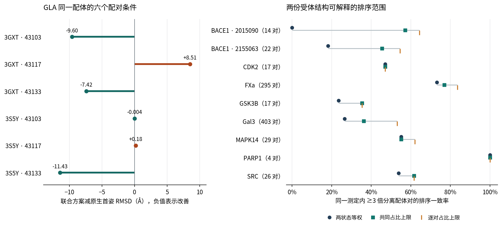

# 从同一结合系综推导姿势和亲和力：FastDock 的证据与边界

历史基线为 `3f21e02`。本轮用两个可以直接否证的命题区分调权不足和表达能力不足：在同一批坐标上，已知正确几何后，已有干分和水或 CH–π 分项能否选中它？给同一测定的所有配体一个共同的游离受体分布，已有状态分数能否解释实测强弱？前者在 344 个历史池中的 149 个得到否定；后者在 Gal3 的 403 个三倍分离对中，给两份现有结构任意共同占比也最多判对 146 对。[固定池判定](../benchmarks/mechanism_interactions/attainability/README.md) · [逐测定上界](../benchmarks/mechanism_interactions/shared_population/README.md)

## 微观系统与两个观测量

在给定温度、压力、pH、盐及化学组成时，溶液中的游离受体、游离配体及复合物各占据一组状态。离子或质子可与体相交换时，统计权重同时含对应化学势；显式保留离散质子化或互变异构态还需要相应内禀自由能和正确的简并度。取 $x=(\mathbf r,\Omega)$ 为相对平移与取向，$y$ 收集蛋白/配体内坐标、水、离子和化学微态。对每个互斥结合盆地 $b$，在选定的统计系综中令

$$
 e^{-\beta W_b(x)}=\frac{\int \mathbf1_b(x,y)\,e^{-\beta H_{\rm eff}(x,y)}\,d\mu(y)}{\int e^{-\beta H_{\rm eff}(\infty,y)}\,d\mu(y)},\qquad \beta=(RT)^{-1}.
$$

离散状态的求和包含在测度内。两积分采用同一温度、标准和溶剂库，分离极限是两个独立、充分平衡的游离伙伴。半巨正则表述下 $H_{\rm eff}$ 包含库交换项；在等压表述中还需一致地处理体积测度。若采用有标签的坐标，需在定义盆地和参考态时一致处理分子对称性。盆地可由内部配体构型和受体侧链定义，即使其相对平移、转动相近，指示函数仍能分开它们。将结合域按盆地分割，取 1 M 标准态、每分子标准体积 $V^\circ\simeq1660.54$ ų 和积分为 $8\pi^2$ 的取向 Haar 测度：

$$
 I_b=\frac1{V^\circ}\int d^3r\,\frac{d\Omega}{8\pi^2} e^{-\beta W_b(r,\Omega)},\quad
 P(b\mid\mathrm{bound})=\frac{I_b}{\sum_j I_j},\quad
 \Delta G^\circ=-RT\ln\sum_j I_j=RT\ln(K_d/C^\circ).
$$

$I_b$ 是无量纲的。若只改变对某盆地的离散方式、把一个盆地分成两个互斥子域，两者积分之和应保持原值。复制一个搜索起点或输出姿势也应保持物理量不变。相反，对去重后的 PDBQT 模式直接做等权指数和，仅重复同一占主导的候选便可人为改变接近 $RT\ln2$，在 298 K 为 0.411 kcal/mol。一个低势能构象与一个高概率盆地不同，后者还要计入该构象附近可达的相空间和游离态代价。[Minh 的原始推导与取样要求](https://doi.org/10.1063/1.4751284) · [Gilson 等的标准态推导](https://doi.org/10.1016/S0006-3495(97)78756-3)

晶体姿势属于具体晶格、构建体与测量条件下的结构观测。溶液中多个盆地的最高占比、最接近单个共晶构象的预测和最小化**预期**几何损失的决策，一般是三个不同的问题。用受体坐标系校正配体化学对称性后再评价 RMSD；为软环或无序取代基保留原子标识、备用构象、占位和输入手性。亲和力使用同一测定内的 $K_d$；$K_i$ 的换算取决于动力学模型和实验条件。尤其慢结合抑制剂的初始与稳态常数可能对应不同终点。[晶格与电子密度核查](../benchmarks/crystal_environment/README.md) · [PNP 初始与慢结合实验](../benchmarks/pnp_kinetics/README.md)

## 物理项何时可相加

电子结构近似产生核坐标的势能；力场常用键合项、短程排斥、色散和静电表示该势。极化、电荷转移、金属配位的电子态以及质子转移取决于模型是否显式容纳这些过程。消去水或蛋白内自由度后得到温度、环境依赖的有效势。在固定的其余坐标上，消去变量 $y$ 的结果是 $-RT\ln\int\exp(-\beta U)\,d\mu(y)$，一般不再是原来的成对势之和。用统一力场里的电荷和范德华参数显式模拟氢键、芳香接触和水后，再加完整的同类经验能量会引入重叠；实际双计多少，需要对同坐标和参考相做替换对照才能确定。用于替换的极化或 QM/MM 模型还必须明确边界、力场参数和游离参考，特别是金属的配位数、配体微态和水交换。[历史极性转移循环及金属处理](../benchmarks/polar_endpoint/README.md) · [CH–π 的量子模型与对接实验](https://doi.org/10.1021/acs.jctc.3c00300) · [水网络巨正则原始研究](https://doi.org/10.1021/jacs.5b07940)

对同一可微哈密顿量 $H(\lambda,\eta)$ 的一个相，混合响应满足

$$
\frac{\partial^2 F}{\partial\lambda\partial\eta}=
 \left\langle\frac{\partial^2 H}{\partial\lambda\partial\eta}\right\rangle
 -\beta\,\operatorname{Cov}\!\left(\frac{\partial H}{\partial\lambda},\frac{\partial H}{\partial\eta}\right).
$$

这个等式由对配分函数求导得到，要求同一测度和固定的状态域。即使两项在微观能量上严格相加，只要它们在同一批微态上的涨落相关，平均自由能也会出现非加和。结合自由能还要扣除游离参考中相应的响应。把四个模型首姿的 RMSD 做差中差，没有得到这个协方差。BACE1 的四臂首姿为 3.885、13.131、11.748、3.885 Å；两个单项选错，合用回到原姿，因子交互读数为 −17.109 Å，几何净收益为零。需要真实系综和受控局部替换才能把这种**选择交互**与能量耦合分开。[四臂原始数据与逐姿势归因](../benchmarks/soft_water_interaction/README.md)

## 历史证据支持哪些机制

| 问题 | 有区分力的证据 | 推断的边界 |
|---|---|---|
| 化学状态能否表达 | 大环虚拟原子执行闭环约束，却不是与实验比较的原子；声明转轴、三元环缺边、刚柔分界的共价邻居，以及跨链装配都有源码或固定坐标反证。 | 能证明原子图、边界或定义错误；修复后仍需单测真实几何和亲和力。[分子图](../benchmarks/declared_rotor_bonds/README.md) · [装配](../benchmarks/assembly_halogen/README.md) · [柔性受体](../benchmarks/flex_covalent_exclusions/README.md) |
| 好姿势在哪一阶段丢失 | FABP4 两臂有相同的 36 个合并输入；改去重可留下一个精修后为 1.800 Å 的候选，但只排第九，首姿仍为 4.331 Å。 | 该次损失可定位到保存与最终排序；从其他最终池的最优值不能反推出未保存轨迹的细节。[合并输入的回放](../benchmarks/archive_overlap/transfer/mechanism/README.md) |
| 水与排斥如何竞争 | BRD9 软搜索和水重排在一个方向选到 0.833 Å，反向选到 10.837 Å。CHEK1 有 1.861 Å 姿势的干分和水位排斥都输给 8.576 Å 姿势。凝血酶完全排开水时，历史模型达到相同的饱和置换罚分。 | 单位点几何排斥容易奖励离开口袋的姿势；现有实验无法区分水的化学势、配体水化、直接结合及受体重组的各自误差。[水的移动与热力学假设](../benchmarks/mobile_water/README.md) · [固定池证据](../benchmarks/mechanism_interactions/attainability/README.md) |
| 更准的局部势能是否够用 | OBC2 与库仑项按同电荷和介电参考做差。hCA II 上，GB 单项判对 20/28 次重复比较，加入耦合的库仑项后为 2/28。更精细的三次网格也曾提高受体场数值精度，六靶首姿阈值命中从 32/66 变为 30/66。 | 替换的量、原经验分中重叠作用、缺失金属响应、候选与输入微态仍然影响预测；这些对照不能反演唯一误差来源。[极性分项](../benchmarks/polar_endpoint/README.md) · [插值与轨迹](../benchmarks/cubic_grid/README.md) |
| 游离态是否对称 | CA IX 五个配体在 pH 7 实测 Kd 基础上转移到 pH 5，零修正、仅配体、仅受体、两者合用的 log₁₀ MAE 为 1.620、0.339、1.912、0.094。另一个碱性区间的同 ITC 测量中心比值 25.58，二位点模型至多允许 3.16。 | 可以说明在特定条件下必须同时计入两相的结合胜任分数，也有定量反例。缓冲成分、紧结合测量的分辨率、其他可离子化位点仍有关。[来源和误差](../benchmarks/proton_linkage/README.md) |
| 内能替换、转子熵和积分是否互补 | 预制首姿下五靶原生、MMFF、接触转子、联合为 89、132、104、131 /187 次逐受体比较。刚体/内部角局部联合积分与分别积分的差值绝对值中位数为 0.267 kcal/mol；Gal3 一组的排序改善同时伴随能差 MAE 0.749→0.904。 | 前者有重叠的纠错配体对；后者确有模型内的运动耦合。两项均未独立测定整个溶液相配分函数。[四臂内能替换](../benchmarks/frozen_core/strain_rotor_interaction/README.md) · [联合积分](../benchmarks/affinity_reference_ensemble/README.md) |
| 有限受体与权重是否足够 | 八个靶点、九个同测定面板上的两个状态代理分说明了对与错都可稳定。PARP1 四个大差异对都判对；GSK3β 的 17 对在两状态的最佳共同占比下最多判对六对。外部 T4 溶菌酶受控计算补齐游离态限制和结合态释放，使两路径之差由 4.31 缩至 0.24 kcal/mol，预测与量热仍差约 1 kcal/mol。 | 可以否证这两份代理分加任意共同占比足以恢复排序。不能由此断定新受体构象一定优于改良条件结合势；外部文献闭合不能当成 FastDock 的自由能精度。[九组同测定界限](../benchmarks/mechanism_interactions/shared_population/README.md) · [外部循环复算](../benchmarks/mechanism_interactions/confine_release/README.md) |

## 两项新结构实验

人 α-半乳糖苷酶 A（GLA）的一种带正电 DGJ 在两份受体、三枚种子上受到检验。3GXT 的文献与沉积配体标识不一致，其坐标和 3S5Y 的 C4 手性确实相反。按照计算前冻结的方案，以 3S5Y 的真实 DGJ 为唯一参考，以另一结构作为接收受体。24k 档常规与 CH–π 搜索的首姿均值为 9.464、6.169 Å，池最小均值 6.946、4.264 Å。按完整分布，四格改善、两格退化，其中一次由 3.666 升至 12.173 Å；新场的所有输出仍超出 2 Å。新池首姿均由干分即可选出。官方 Vina 24k 与当前 Pro 48k 的均值为 8.761、9.936 Å。已知晶体时，单用输入图构象的刚体自由度即可构造 1.165 Å 的姿势。其本地精修结果在 3S5Y 为 1.338 Å，但按同一零点重评仍输给该受体全部六个池的干分赢家。这把“远离晶体是否源自输入构象完全无法表达”和“精修与选姿能否识别那个区域”分开了。[化学身份、局部反事实与计时](../benchmarks/ch_pi_search/gla_transfer/README.md)

在 HSP90α、组织蛋白酶 D 与 CDK2 三个大环体系中，父版将真实共价环切开作为搜索坐标，在 CG–G 辅助标记距超过 20 Å 时却把恢复力和能量都截为零。历史 XS 研究补丁在雷帕霉素上已有先例。本轮将固定拓扑的线性恢复项延续到原有有限插值表外，并在 AD4 中分开普通非键截断和闭环项，对三种评分路径实际验证。几何约束仍独立于最终经验亲和力。修复前，若直接按打印的最终能量为四轨迹网格结果重新排序，60 个前五名中的严重断键会从 0 增至 6。修复后四轨迹网格/显式精修中，标记偏差 ≥20 Å 的输出各由 2 降为 0，真实闭环碳距 >3 Å 的输出由 51/188 降至 45/189、10/210 降至 8/209。两组首姿与池内最优均值维持原值，前五最好值均值增加约 0.052 Å。固定坐标的 FKBP12 同测定 AD4 亲和力评分也未改变。正确施加约束排除了一种虚假势阱，但没有保证整个环回到真实结合盆地。[源码数值检验、原始输出、分布及空池](../benchmarks/mechanism_interactions/macrocycle_selection/README.md) · [历史长程闭环研究](../benchmarks/bond_distance/README.md)

左图每行对应同一配体在特定受体与种子上的一次配对。右图为实测差异至少三倍的分子对，标出按等权**预测**所得的分数，以及两种使用标签的数学上界；比较单位和分母只在同一行内解释。[绘图程序](../benchmarks/mechanism_interactions/plot_bounds.py)

## 算法应在哪里使用哪些量

1. **可行构象和提议。** 从化学图与立体化学建立构象空间，把禁止的断键构象当作约束失效。快速搜索场可有意软化能垒。保存到精修前的坐标和能量后，才有可能区分未访问、存储淘汰和精修逃离；不同搜索场的出现次数不能直接代作平衡权重。
2. **盆地自由能与选姿。** 给互斥盆地相同的化学图、相同物理模型和充分的局部积分，才能比较其质量 $I_b$。高保真势不应只看已经由低保真分筛出来的第一名；保留有几何差异的候选，并验证早期筛选会丢失多少可评估的状态。扩展构象空间时同时报告覆盖和可排序性。晶体作为对照时需核查空间群接触、电子密度和同一配体在不同受体中的坐标对应。
3. **同靶同测定的亲和力。** 对多个受体/游离配体微态采用共同定义的游离参考。若物理模型能估计受限结合和游离受体占比，可按配分函数相加。若采用炼金相对自由能，等价的热力学循环为 $\Delta\Delta G_{A\to B}=\Delta G_{A\to B}^{\rm complex}-\Delta G_{A\to B}^{\rm solution}$；两条腿的化学身份、微态、溶剂、净电荷变更和标准状态要一致。检查重复轨迹及相邻状态的重叠，同时报告对不同受体起点的敏感性。已有实现支持读取真实 OpenFE 两相结果；本轮没有产生新的两相模拟或绝对自由能评测。[现有双相接口](EXPLICIT_RBFE.md) · [受体限制与释放](https://doi.org/10.1021/ct700032n)

下一项最有区分力的实验，是选择能分辨两种受体构象、且能独立测得或采样其游离占比的体系，在同一同系列测定内检验**各状态内的结合分差**。优先比较现有两个状态都给错方向的配体对：单改占比对此没有解释力。固定受体域、同一配体微态，用溶液腿和受限复合物腿分别计算，再补回限制/释放项；同时设置原先两态都给对方向的对照。若状态内分差仍错，先检验电荷/水化/微态与采样重叠；若同态结果正确而总体错，再测试受体占比和遗漏盆地。这个次序从可否证性推出，无须事先宣称所有体系都缺同一个力项。
